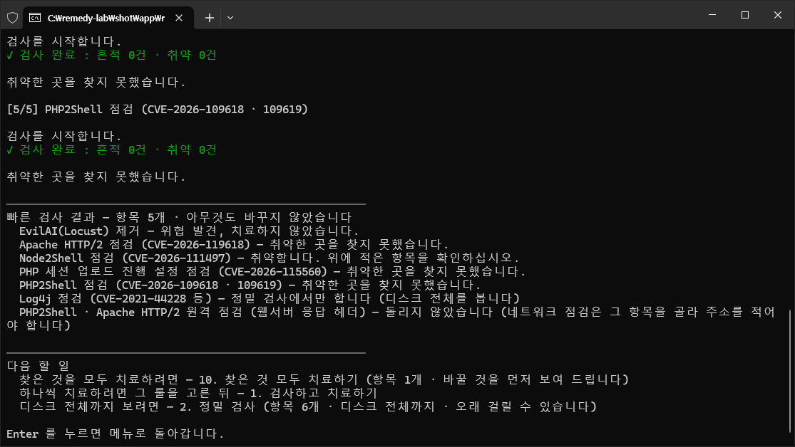
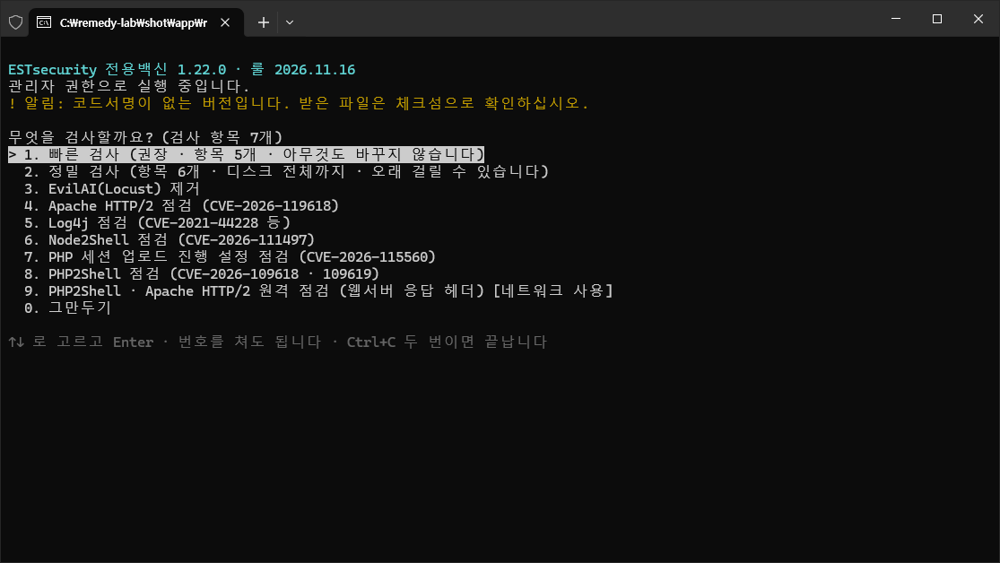
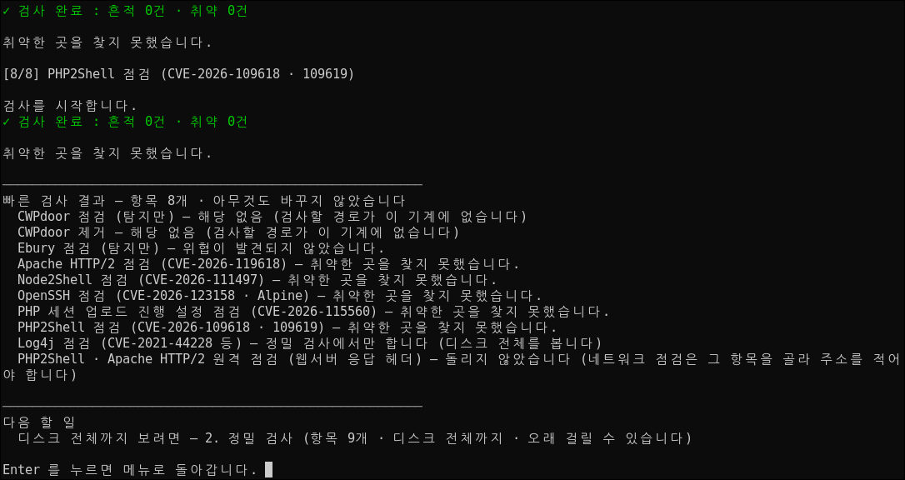

# remedy — ESTsecurity 전용백신

[](https://github.com/ESTsecurity/remedy/actions/workflows/ci.yml)
[](https://github.com/ESTsecurity/remedy/releases/latest)


설치 없이 실행해 특정 위협을 **찾고, 치료하고, 되돌릴 수 있는** 전용백신입니다. Windows · Linux 에서 씁니다.



- **보여 드린 뒤에 바꿉니다** — 검사는 아무것도 바꾸지 않습니다. 치료는 바꿀 것을 모두 보여 드리고 승인을 받아야 시작합니다.
- **되돌릴 수 있습니다** — 지운 파일은 격리해 두었다가 메뉴의 *치료 전으로 복원하기* 로 되돌립니다.
- **통신하지 않습니다** — 검사 · 치료 실행 파일에는 네트워크 기능이 없어 폐쇄망에서도 그대로 씁니다. 네트워크를 쓰는 *원격
  점검* 한 항목은 따로 든 `remedy-net` 이 맡고, 고르기 전에 알려 드립니다.
- **서명된 룰만 씁니다** — 실행 파일에 박힌 공개키로 룰의 서명을 확인합니다.

## 빠르게 시작

1. **받기** — [최신 버전](https://github.com/ESTsecurity/remedy/releases/latest)에서 쓰는 곳에 맞는 파일 하나를 받습니다.
   파일 하나에 프로그램과 그 OS 의 룰이 모두 들어 있습니다.

   | 쓰는 곳 | 받을 파일 |
   |---|---|
   | Windows 10 · 11 · Server 2016 이상 (x64) | `remedy-windows-x64.zip` |
   | 리눅스 x86_64 — RHEL 계열 · Debian · Ubuntu · Alpine | `remedy-linux-x64.tar.gz` |

2. **확인 (권장)** — 같은 자리의 `SHA256SUMS` 로 받은 파일이 배포한 그 파일인지 봅니다([받은 파일 확인](#받은-파일-확인)).
3. **실행**
   - **Windows** — zip 을 *모두 압축 풀기* 로 풀고 `remedy.exe` 를 더블클릭합니다. 관리자 권한 없이 열리면 첫 화면의
     **1. 관리자 권한으로 다시 열기** 를 고르고, 사용자 계정 컨트롤 창에서 [예] 를 누릅니다.
   - **리눅스**

     ```sh
     tar -xzf remedy-linux-x64.tar.gz && cd remedy-linux-x64
     sudo ./remedy
     ```

4. **고르기** — 무엇인지 모르면 **1. 빠른 검사** 입니다. 치료할 것이 나오면 같은 화면에 서는 **찾은 것 모두 치료하기** 로
   한 번에 치료합니다. 디스크 전체까지 보려면 **2. 정밀 검사** 입니다(오래 걸릴 수 있습니다).



> **PC · 서버마다 그 기계의 로컬 디스크에 풀어 실행하십시오**(예: `C:\remedy` · `/root/remedy`). 격리한 파일과 치료
> 기록이 받은 폴더의 `state` 에 남습니다 — 치료한 뒤 그 폴더를 지우면 되돌릴 수 없습니다.

## 다루는 위협

<!-- threats:begin — `cargo xtask threats --write` 가 룰에서 만든다. 손으로 고치지 않는다 -->
| 룰 | 하는 일 | Windows | Linux | 참고 |
|---|---|---|---|---|
| Apache HTTP/2 점검 (CVE-2026-119618) | 찾기만 합니다 | `apache-http2-check-windows` 0.1.1 | `apache-http2-check-linux` 0.1.2 | [httpd.apache.org](https://httpd.apache.org/security/vulnerabilities_24.html) |
| EvilAI(Locust) 제거 | 찾아서 치료합니다 (복원할 수 있습니다) | `evilai-locust` 0.2.0 | — | [www.virustotal.com](https://www.virustotal.com/gui/search/engines%3Ameadowlocust) |
| Java4Shell 점검 (CVE-2026-114938) | 찾기만 합니다 | `java4shell-check-windows` 0.3.0 | `java4shell-check-linux` 0.3.0 | [openjdk.org](https://openjdk.org/groups/vulnerability/advisories/2026-11-17) |
| Log4j 점검 (CVE-2021-44228 등) | 찾기만 합니다 | `log4j-check` 0.2.1 | `log4j-check` 0.2.1 | [logging.apache.org](https://logging.apache.org/security.html) |
| nginx2root 점검 (CVE-2026-123007 · CVE-2026-123634 · CVE-2026-123633 · CVE-2026-121810 · CVE-2026-113425) | 찾기만 합니다 | `nginx2root-check-windows` 0.1.0 | `nginx2root-check-linux` 0.1.1 | [xint.io](https://xint.io/ko/blog/nginx2root-remote-code-execution) |
| Node2Shell 점검 (CVE-2026-111497) | 찾기만 합니다 | `node2shell-check-windows` 0.4.1 | `node2shell-check-linux` 0.6.1 | [nodejs.org](https://nodejs.org/en/blog/vulnerability/october-2026-security-releases) |
| PHP 세션 업로드 진행 설정 점검 (CVE-2026-115560) | 찾기만 합니다 | `php-session-check-windows` 0.4.1 | `php-session-check-linux` 0.5.1 | [www.php.net](https://www.php.net/archive/2026.php) |
| PHP2Shell 점검 (CVE-2026-109618 · 109619) | 찾기만 합니다 | `php2shell-check-windows` 0.4.1 | `php2shell-check-linux` 0.6.1 | [www.php.net](https://www.php.net/archive/2026.php) |
| PHP2Shell · Apache HTTP/2 원격 점검 (웹서버 응답 헤더) | 적어 주신 주소의 서버를 바깥에서 봅니다 (네트워크 사용) | `php2shell-url-check` 0.2.0 | `php2shell-url-check` 0.2.0 | [www.php.net](https://www.php.net/archive/2026.php) |
| CWPdoor 점검 (탐지만) | 찾기만 합니다 | — | `cwpdoor-1-check` 0.1.2 | [blog.xlab.qianxin.com](https://blog.xlab.qianxin.com/cwpdoor-the-invisible-backdoor-living-inside-control-web-panel/) |
| CWPdoor 제거 | 찾아서 치료합니다 (복원할 수 있습니다) | — | `cwpdoor-2-clean` 0.1.2 | [blog.xlab.qianxin.com](https://blog.xlab.qianxin.com/cwpdoor-the-invisible-backdoor-living-inside-control-web-panel/) |
| Ebury 점검 (탐지만) | 찾기만 합니다 | — | `ebury-check` 0.2.0 | [www.welivesecurity.com](https://www.welivesecurity.com/en/eset-research/ebury-alive-unseen-400k-linux-servers-compromised-cryptotheft-financial-gain/) |
| OpenSSH 점검 (CVE-2026-123158 · Alpine) | 찾기만 합니다 | — | `openssh-musl-check` 0.1.2 | [github.com](https://github.com/advisories/GHSA-4fcc-vm97-gx3x) |
<!-- threats:end -->

치료한 뒤 꼭 할 일과 이 도구가 보지 못하는 것은 위협마다 다릅니다 — [위협별 안내](#위협별-안내).

## 화면 읽기

작업이 끝나면 결과 한 줄과 **다음 할 일** 이 메뉴 번호로 이어 갈 곳을 알려 드립니다. 고른 항목의 메뉴에서 `0` 은 검사
항목을 고르는 화면으로 돌아가고, 그 화면의 `0` 이 끝내기입니다. 기록 · 프로그램 정보 · 운영자 · 룰 작성자 명령은 메뉴
마지막의 **더 보기** 에 있습니다.

| 결과 줄 | 뜻 · 할 일 |
|---|---|
| 위협이 발견되지 않았습니다. | 그 항목이 아는 위협이 이 기계에 없습니다. |
| 위협 발견, 치료 완료 | 치료했습니다. 오탐이라고 판단되면 *치료 전으로 복원하기* 로 되돌립니다. |
| 위협 발견, 치료하지 않았습니다. | 검사만 했거나 승인하지 않았습니다. |
| 일부 실패 · 치료하지 못했습니다 | 바로 위 *실패* 줄에 무엇을 왜 못 했는지 있습니다 — 까닭을 해결한 뒤 다시 검사하고 치료합니다. |
| 취약합니다. | 점검 항목이 취약한 버전을 찾았습니다 — 적힌 프로그램을 고친 버전으로 올리고 서비스를 다시 시작합니다. |
| 확인이 필요합니다. | 판정할 근거가 없는 설치본 · 설정입니다 — 위 *주의* 줄이 무엇을 확인할지 말합니다. |
| 다 보지 못해 … 말할 수 없습니다. | 볼 자리를 다 보지 못했습니다 — 위 *주의* 줄에 까닭이 있습니다. |
| 해당 없음 | 그 항목이 보는 제품이 이 기계에 없습니다(빠른 · 정밀 검사의 요약). |



## 위협별 안내

위협마다의 *치료하면 바뀌는 것 · 꼭 할 일 · 못 보는 것* 은 [`docs/위협별-안내.md`](docs/위협별-안내.md) 에 있습니다.
인터넷이 막힌 곳이면 받은 폴더의 `plugins/<룰>/RELEASE.md` 에 같은 차례가 있습니다.

| 위협 | OS | 안내 |
|---|---|---|
| CWPdoor (Control Web Panel) | Linux | [치료 뒤 할 일](docs/위협별-안내.md#cwpdoor) |
| Ebury (sshd) | Linux | [찾았을 때 할 일](docs/위협별-안내.md#ebury) |
| EvilAI(Locust) | Windows | [치료 뒤 할 일](docs/위협별-안내.md#evilai-locust) |
| Log4j | Windows · Linux | [점검 결과 읽기](docs/위협별-안내.md#log4j) |
| Java — Java4Shell | Windows · Linux | [점검 결과 읽기](docs/위협별-안내.md#java4shell) |
| OpenSSH (Alpine) | Linux | [점검 결과 읽기](docs/위협별-안내.md#openssh-musl) |
| Apache HTTP/2 | Windows · Linux | [점검 결과 읽기](docs/위협별-안내.md#apache-http2) |
| nginx — nginx2root | Windows · Linux | [점검 결과 읽기](docs/위협별-안내.md#nginx2root) |
| Node.js — Node2Shell | Windows · Linux | [점검 결과 읽기](docs/위협별-안내.md#node2shell) |
| PHP — PHP2Shell · 세션 업로드 진행 설정 | Windows · Linux | [점검 결과 읽기](docs/위협별-안내.md#php2shell) |
| 원격 점검 — 웹서버 응답 헤더 | Windows · Linux | [쓰는 법 · 한계](docs/위협별-안내.md#url-check) |
| 이미지 파일 · 컨테이너 | Windows · Linux | [쓰는 법](docs/위협별-안내.md#image-container) |

## 받은 파일 확인

받은 파일과 같은 자리의 `SHA256SUMS` 를 한 폴더에 두고 **실행하기 전에** 봅니다.

- **Windows** — PowerShell 에서 받은 폴더로 이동한 뒤(`cd $HOME\Downloads`) 아래 한 줄을 넣습니다. `True` 면 같은 파일입니다.

  ```powershell
  (Get-FileHash remedy-windows-x64.zip).Hash -eq (Select-String windows SHA256SUMS).Line.Split(' ')[0]
  ```

- **리눅스** — `OK`(한국어 환경에서는 `성공`)면 같은 파일입니다.

  ```sh
  curl -LO https://github.com/ESTsecurity/remedy/releases/latest/download/remedy-linux-x64.tar.gz
  curl -LO https://github.com/ESTsecurity/remedy/releases/latest/download/SHA256SUMS
  grep linux SHA256SUMS | sha256sum -c
  ```

`False` · `FAILED`(`실패`)가 나오면 **실행하지 말고** 지운 뒤 다시 받으십시오. 버전은 둘입니다 — **프로그램 버전**
(`1.24.0`)과 **룰 버전**(날짜 · `2026.11.18.3`). 실행하면 화면 맨 위에 둘 다 보입니다.

## 요구 사항 · 하지 않는 것

- **관리자 권한** — Windows 는 관리자, 리눅스는 root(`sudo`). *원격 점검* 과 이미지 파일 점검은 권한이 없어도 됩니다.
- **받은 폴더에 쓸 수 있어야 합니다** — 결과(`out`)와 치료 기록(`state`)을 그 폴더에 남깁니다. 빠른 · 정밀 검사는 찾았거나
  확인이 필요한 항목의 결과 파일만 남깁니다.
- 실시간 감시 · 상주 프로그램이 아닙니다 — 필요할 때 띄워 쓰는 도구입니다. 그래픽 화면(GUI)이 없습니다.
- 위 *다루는 위협* 표의 위협만 다룹니다. 32비트 Windows · ARM 리눅스 용 파일은 내지 않습니다.
- **Windows 실행 파일은 1.24.0 부터 코드서명(Authenticode)돼 있습니다** — 프로그램이 시작할 때 스스로 확인하고, 루트
  인증서를 갖지 않은 오프라인 기계에서는 확인하지 못했다고 알리기만 합니다. 받은 파일은 체크섬으로도 확인할 수 있습니다.
  룰은 서명돼 있고 실행 파일이 그 서명을 확인합니다.

## 무인 배포 · 종료 코드

인자를 주면 메뉴 없이 돌고(승인을 묻지 않으려면 `--yes`), 결과를 종료 코드로 알립니다. 모르는 옵션은 실행하지 않고 4 로
끝납니다.

```powershell
.\remedy.exe run --plugin .\plugins\evilai-locust\plugin.yaml --yes
```

```sh
sudo ./remedy run --plugin ./plugins/cwpdoor-2-clean/plugin.yaml --yes
```

| 종료 코드 | 뜻 |
|---|---|
| 0 | 위협 없음 |
| 1 | 발견 · 치료 완료 |
| 2 | 발견 · 치료 안 함 (*점검* 항목은 *취약*) |
| 3 | 부분 실패 |
| 4 | 사용법 · 입력 오류 |
| 5 | 안전 가드 중단 (권한 없음 포함) |
| 6 | 관측 불완전 — '위협 없음' 을 말할 수 없음 (*점검* 항목은 *확인 필요*) |
| 7 | 내부 오류 |

Windows 는 치료 뒤 다시 시작해 관리자 계정으로 로그온하면 자동으로 한 번 더 검사합니다. 되돌리기 · 재검사 · 신고 · 룰의 서명
확인(`plugin verify`) · 사내 룰은 [운영자 가이드](docs/operator.md)에 있습니다.

## 문서

| 누가 | 어디로 |
|---|---|
| 현장에서 **돌리는** 사람 | [`docs/operator.md`](docs/operator.md) — 배포 · 실행 · 되돌리기 · 신고 |
| 위협마다의 할 일 | [`docs/위협별-안내.md`](docs/위협별-안내.md) |
| 새 버전을 받는 사람 | [`docs/업데이트-내역.md`](docs/업데이트-내역.md) — 버전마다 달라진 점 |
| 구조를 알고 싶은 사람 | [`docs/remedy-전체-그림.md`](docs/remedy-전체-그림.md) — 기능 · 동작 · 배포 · 구조 |
| 화면이 궁금한 사람 | [`docs/design/콘솔은-이렇게-보인다.md`](docs/design/콘솔은-이렇게-보인다.md) |
| 룰을 **쓰는** 사람 | [`docs/plugin-guide/`](docs/plugin-guide/README.md) |
| 코어를 **고치는** 사람 | [`docs/개발-안내.md`](docs/개발-안내.md) — 저장소 규칙 · 커밋 전 검증 · 출시 |
| 이슈를 **처리하는** 사람 | [`docs/이슈-처리.md`](docs/이슈-처리.md) |

## 지원 · 신고

- **버그 · 오탐 · 위협 지원 요청** — [Issues](https://github.com/ESTsecurity/remedy/issues/new/choose) 에서 맞는 양식을 골라
  올려 주십시오. **이슈는 누구나 볼 수 있습니다** — 사용자 이름 · 호스트명은 가려 적고, 파일은 이슈에 붙이지 마십시오.
- **파일** — 메뉴의 *신고에 붙일 것 모으기* 로 만든 신고 묶음 · 결과 파일은 이슈 번호를 적어 이 도구를 나눠 준 조직의
  담당자에게, GitHub 에서 직접 받으셨다면 `security@estsecurity.com` 으로 보내 주십시오. **신고 묶음에는 경로 · 호스트명 ·
  사용자명이 가려지지 않고 들어 있습니다** — 공개된 곳에 올리지 마십시오.
- **보안 취약점** — 공개 이슈로 올리지 마시고 [`SECURITY.md`](SECURITY.md) 의 신고 경로로 보내 주십시오.
- **기여** — ESTsecurity 가 관리하는 독점 소프트웨어라 외부 기여(Pull Request)는 받지 않습니다.

## 라이선스

Copyright ESTsecurity. All rights reserved. — 독점 라이선스입니다([`LICENSE`](LICENSE)). 저장소는 공개돼 있지만
오픈소스가 아닙니다.
