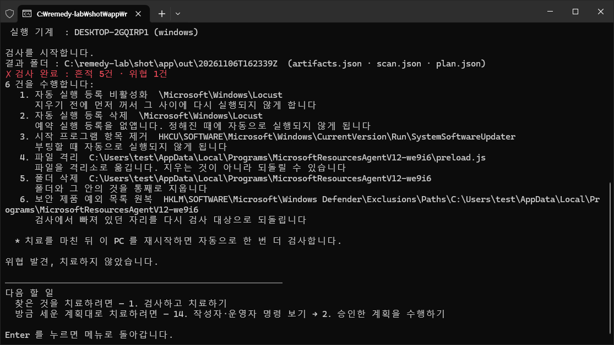
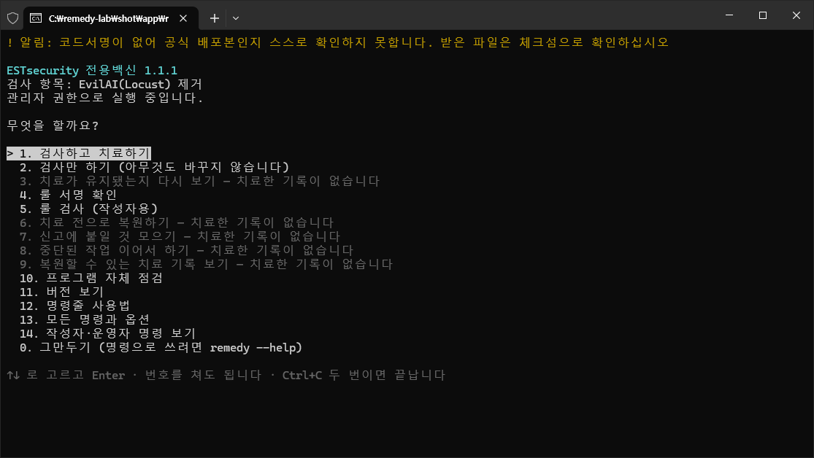
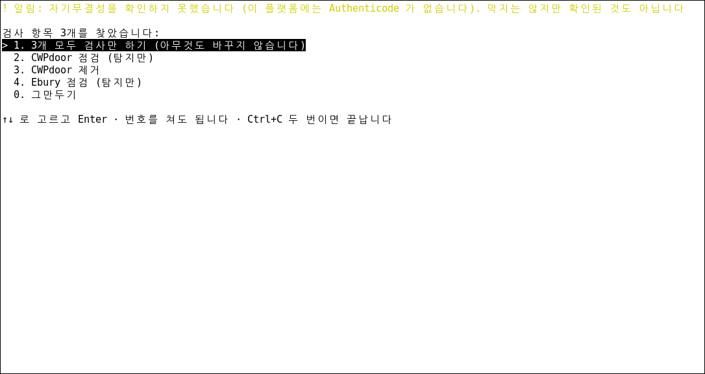
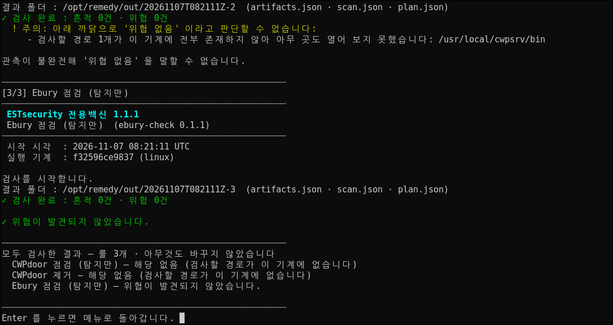

# remedy — ESTsecurity 전용백신

[](https://github.com/ESTsecurity/remedy/actions/workflows/ci.yml)
[](https://github.com/ESTsecurity/remedy/releases/latest)


**remedy** 는 **ESTsecurity 가 만들고 관리하는 전용백신**입니다. 아래 표의 악성코드가 남긴
파일 · 자동 실행 등록 · 보안 제품 예외를 찾아 치료하고, 치료한 것은 격리해 두어 **되돌릴 수
있습니다.** 표의 *점검* 항목은 PHP · Node.js 의 알려진 취약점이 이 기계에 있는지 알려 드립니다 —
아무것도 바꾸지 않습니다. *원격 점검* 항목은 적어 주신 주소의 웹서버를 바깥에서 봅니다 — 네트워크를
쓰는 것은 이 항목뿐이고, 고르기 전에 그렇다고 알려 드립니다. 설치 없이, 받은 폴더에서 바로 실행합니다.

## 다루는 위협

받기 전에 확인하십시오 — 아래 룰이 그 OS 용 파일 하나에 모두 들어 있습니다.

<!-- threats:begin — `cargo xtask threats --write` 가 룰에서 만든다. 손으로 고치지 않는다 -->
| 룰 | 하는 일 | OS | 폴더 · 버전 | 참고 |
|---|---|---|---|---|
| EvilAI(Locust) 제거 | 찾아서 치료합니다 (복원할 수 있습니다) | Windows | `evilai-locust` 0.2.0 | [www.virustotal.com](https://www.virustotal.com/gui/search/engines%3Ameadowlocust) |
| Node2Shell 점검 (CVE-2026-111497) | 찾기만 합니다 | Windows | `node2shell-check-windows` 0.2.0 | [nodejs.org](https://nodejs.org/en/blog/vulnerability/october-2026-security-releases) |
| PHP 세션 업로드 진행 설정 점검 (CVE-2026-115560) | 찾기만 합니다 | Windows | `php-session-check-windows` 0.2.0 | [www.php.net](https://www.php.net/archive/2026.php) |
| PHP2Shell 점검 (CVE-2026-109618 · 109619) | 찾기만 합니다 | Windows | `php2shell-check-windows` 0.2.0 | [www.php.net](https://www.php.net/archive/2026.php) |
| PHP2Shell 원격 점검 (웹서버 응답 헤더) | 적어 준 주소의 서버를 바깥에서 봅니다 (네트워크 사용) | Windows · Linux | `php2shell-url-check` 0.1.0 | [www.php.net](https://www.php.net/archive/2026.php) |
| CWPdoor 점검 (탐지만) | 찾기만 합니다 | Linux | `cwpdoor-1-check` 0.1.2 | [blog.xlab.qianxin.com](https://blog.xlab.qianxin.com/cwpdoor-the-invisible-backdoor-living-inside-control-web-panel/) |
| CWPdoor 제거 | 찾아서 치료합니다 (복원할 수 있습니다) | Linux | `cwpdoor-2-clean` 0.1.2 | [blog.xlab.qianxin.com](https://blog.xlab.qianxin.com/cwpdoor-the-invisible-backdoor-living-inside-control-web-panel/) |
| Ebury 점검 (탐지만) | 찾기만 합니다 | Linux | `ebury-check` 0.2.0 | [www.welivesecurity.com](https://www.welivesecurity.com/en/eset-research/ebury-alive-unseen-400k-linux-servers-compromised-cryptotheft-financial-gain/) |
| Node2Shell 점검 (CVE-2026-111497) | 찾기만 합니다 | Linux | `node2shell-check-linux` 0.2.0 | [nodejs.org](https://nodejs.org/en/blog/vulnerability/october-2026-security-releases) |
| PHP 세션 업로드 진행 설정 점검 (CVE-2026-115560) | 찾기만 합니다 | Linux | `php-session-check-linux` 0.2.0 | [www.php.net](https://www.php.net/archive/2026.php) |
| PHP2Shell 점검 (CVE-2026-109618 · 109619) | 찾기만 합니다 | Linux | `php2shell-check-linux` 0.2.0 | [www.php.net](https://www.php.net/archive/2026.php) |
<!-- threats:end -->

## 처음 쓰시는 분 — 다섯 단계

### 1. 받기

[**최신 버전**](https://github.com/ESTsecurity/remedy/releases/latest)에서 쓰는 곳에 맞는 파일
**하나**를 받습니다. 파일 하나에 프로그램과 그 OS 용 룰이 모두 들어 있습니다. 이전 버전과 달라진 점은 그
화면 맨 위와 [업데이트 내역](docs/업데이트-내역.md)에 있습니다.

| 쓰는 곳 | 받을 파일 |
|---|---|
| Windows PC · 서버 (64비트) | `remedy-windows-x64.zip` |
| 리눅스 서버 (64비트) | `remedy-linux-x64.tar.gz` |

같은 화면 맨 아래의 *Source code* 두 개와 *Release attestation (json)* 은 개발 · 검증용입니다 — 받지
않으셔도 됩니다.

리눅스 서버에서 바로 받으려면:

```sh
curl -LO https://github.com/ESTsecurity/remedy/releases/latest/download/remedy-linux-x64.tar.gz
curl -LO https://github.com/ESTsecurity/remedy/releases/latest/download/SHA256SUMS
```

### 2. 받은 파일 확인 (권장)

받은 파일이 배포한 그 파일인지 **실행하기 전에** 확인합니다. 같은 자리의 `SHA256SUMS` 를 받아
같은 폴더에 두고 실행하십시오.

**Windows** — PowerShell 을 열어 받은 폴더로 이동한 뒤(`cd $HOME\Downloads`) 아래 한 줄을
넣습니다. `True` 가 나오면 같은 파일입니다.

```powershell
(Get-FileHash remedy-windows-x64.zip).Hash -eq (Select-String windows SHA256SUMS).Line.Split(' ')[0]
```

**리눅스** — `OK`(한국어 환경에서는 `성공`)가 나오면 같은 파일입니다.

```sh
grep linux SHA256SUMS | sha256sum -c
```

`False` · `FAILED`(한국어 환경에서는 `실패`)가 나오면 **실행하지 말고** 받은 파일을 지운 뒤 다시
받으십시오.

### 3. 풀고 실행하기

**Windows**

1. 받은 zip 을 **폴더째** 풉니다(탐색기에서 마우스 오른쪽 단추 → **모두 압축 풀기**. 알집 · 반디집이면
   폴더로 푸는 메뉴를 고릅니다). zip 을 연 채로 실행하거나 파일을 따로 옮기면 동작하지 않습니다.
   풀린 폴더 안에 `remedy-windows-x64` 폴더가 한 겹 더 있으면 그 안으로 들어갑니다.
2. 풀린 폴더의 `remedy.exe` 를 마우스 오른쪽 단추로 누르고 **관리자 권한으로 실행** 을
   고릅니다. 파란 창(SmartScreen)이 뜨면 위 2단계로 확인한 뒤 [추가 정보] → [실행] 을
   누릅니다 — 인터넷에서 받은 실행 파일 가운데 아직 평판이 쌓이지 않은 것에 뜨는 창입니다(코드서명이
   있어도 배포 초기에는 뜹니다). 이어서 뜨는 사용자 계정 컨트롤 창에는
   [예] 를 누릅니다 — 관리자 권한으로 실행하면 늘 뜨는 창이고, 코드서명이 없어 게시자가 '알 수
   없음' 으로 나옵니다.

**리눅스**

```sh
tar -xzf remedy-linux-x64.tar.gz
cd remedy-linux-x64
sudo ./remedy
```

화면이 영어로 나오면(서버의 언어 설정이 한국어가 아닐 때) `sudo ./remedy --lang ko` 로 띄웁니다.

**PC · 서버마다 그 기계의 로컬 디스크에 풀어 실행하십시오**(예: `C:\remedy` · `/root/remedy`). USB 나
공유 폴더에서 바로 실행하면 치료 기록과 격리한 파일이 그 매체에 남아, 매체를 빼면 그 기계를 되돌릴
수 없고 재시작 뒤 자동 검사도 그 경로를 찾지 못합니다.

### 4. 무엇을 누르나

받은 파일에 검사 항목이 여럿이라(Windows 다섯 · 리눅스 일곱) 먼저 무엇을 볼지 묻습니다.

- 어떤 위협인지 모르면 **1. 모두 검사만 하기** 를 고릅니다(화면에는 *4개 모두* 처럼 이 기계를 검사하는
  항목 수가 붙습니다) — 아무것도 바꾸지 않고 결과를 한 번에 보여 드립니다.
- 치료는 그 항목(예: Windows 의 *EvilAI(Locust) 제거*)을 고른 뒤 **1. 검사하고 치료하기** 로 합니다. 바꾸기
  전에 먼저 보려면 **2. 검사만 하기** 입니다. 치료는 바꿀 것을 모두 보여 드린 뒤 `예` 를 받아야 시작합니다.
- *점검* · *탐지만* 항목은 고르면 **1. 검사만 하기** 가 맨 위에 섭니다 — 바꾸는 것이 없습니다.
- 이름 뒤에 **[네트워크 사용]** 이 붙은 항목(*PHP2Shell 원격 점검*)은 이 기계가 아니라 **적어 주신 주소의
  웹서버**를 봅니다. 고르면 **1. 원격 점검하기** 가 서고, 네트워크를 쓴다고 알린 뒤 이용 조건 동의와 주소를
  묻습니다. *모두 검사만* 에는 들지 않고, 그 요약에 *돌리지 않았습니다* 로 적힙니다([원격 점검 안내](#php2shell-원격-점검--웹서버-응답-헤더-네트워크를-씁니다)).

치료한 뒤에는 *치료 전으로 복원하기 · 치료가 유지됐는지 다시 보기 · 신고에 붙일 것 모으기* 가 메뉴에
나타납니다. 그 밖의 명령(프로그램 자체 점검 · 명령줄 사용법 · 룰 작성자 · 운영자 명령)은 메뉴 마지막의
**더 보기** 에 있습니다. 작업이 끝나면 처음 화면으로 돌아옵니다. 끝내려면 **0** 을 고릅니다.

### 5. 결과 읽기

| 결과 줄 | 뜻 · 할 일 |
|---|---|
| 위협이 발견되지 않았습니다. | 그 항목의 위협이 없습니다. |
| 위협 발견, 치료 완료 (N건 수행 완료) | 치료했습니다. 오탐이라고 판단되면 메뉴의 **치료 전으로 복원하기** 로 되돌립니다. |
| 일부 실패 (N건 수행 완료) | 몇 가지를 바꾸지 못했습니다 — 바로 위 *실패* 줄에 무엇을 왜 못 했는지 있습니다. 이미 바꾼 것은 그대로 두었으니, 까닭을 해결한 뒤 다시 검사하고 치료합니다. 다시 검사가 *위협이 발견되지 않았습니다* 로 끝나도 실패 줄의 항목은 남아 있습니다 — 직접 지우거나 담당자에게 알리십시오. |
| 위협 발견, 치료하지 않았습니다. | 검사만 했거나 치료를 승인하지 않았습니다. 치료하려면 그 항목의 **1. 검사하고 치료하기** 를 고릅니다. *(탐지만)* 항목은 아래 [위협별 안내](#위협별-안내)를 따르십시오. |
| 관측이 불완전해 '위협 없음' 을 말할 수 없습니다. | 다 보지 못했습니다 — 바로 위 *주의* 줄에 까닭이 있습니다. |
| 취약합니다. 위에 적은 항목을 확인하십시오. | *점검* 항목이 취약한 버전을 찾았습니다 — 적힌 프로그램을 고친 버전으로 올리고 그것을 쓰는 서비스를 다시 시작합니다([위협별 안내](#위협별-안내)). |
| 확인이 필요합니다. 위에 적은 항목은 '취약하지 않다' 를 가릴 근거가 없습니다. | *점검* 항목이 판정할 근거가 없는 설치본 · 설정입니다 — 위 *주의* 줄이 무엇을 확인할지(버전 · 받은 곳 · 설정) 말합니다. |
| 취약한 곳을 찾지 못했습니다. | *점검* 항목이 본 자리에서 취약한 버전을 찾지 못했습니다 — 그 프로그램(PHP · Node.js)이 이 기계에 없을 때도 이렇게 나옵니다. |
| 해당 없음 (검사할 경로가 이 기계에 없습니다) | *모두 검사만* 의 요약 줄입니다. 그 항목이 검사하는 제품이 이 서버에 없습니다 — Control Web Panel(CWP)을 쓰지 않는 서버의 CWPdoor 두 항목이 이렇게 나옵니다. |
| 돌리지 않았습니다 (네트워크 점검은 그 항목을 골라 주소를 적어야 합니다) | *모두 검사만* 의 요약 줄입니다. *네트워크 사용* 이 붙은 항목은 점검할 주소를 적어야 해서 한꺼번에 돌리지 않습니다 — 그 항목을 골라 실행합니다. |

작업 뒤에는 결과에 맞는 **다음 할 일을 메뉴 번호로** 알려 드립니다.

**치료한 뒤에는 받은 폴더를 지우지 마십시오.** 메뉴로 치료한 기록과 격리한 파일은 받은 폴더
안의 `state` 에 남습니다. 폴더를 지우면 되돌릴 수 없습니다 — 되돌릴 일이 없다고 판단한 뒤에
지우십시오. 되돌릴 때는 그 폴더의 `remedy` 를 **치료할 때처럼 관리자 권한(리눅스는 `sudo`)으로**
다시 띄워 메뉴에서 고릅니다 — 권한 없이 띄우면 기록을 읽지 못합니다.

## 위협별 안내

위협마다 세 줄로 먼저 적었습니다 — 치료하면 무엇이 바뀌는지(점검 항목은 무엇을 보는지) · 꼭 할 일 · 이 도구가 못
보는 것. 차례와 까닭은 펼쳐서 보십시오.

### CWPdoor — Control Web Panel 을 쓰는 리눅스 서버

- **치료하면** 백도어가 든 `cwpsrv` 를 **격리**하고, 그것을 띄우는 `cwpsrv.service` 를 **멈추고 지웁니다.**
- **꼭 할 일** 공급사의 **최신 버전**으로 패널을 다시 설치해 켜고(`yum install cwpsrv` →
  `systemctl enable --now cwpsrv`), **패널 자격 증명을 모두 바꿉니다.**
- **못 보는 것** 서명 키가 다른 배포 · 지금 돌고 있는 창구 — 패널을 되살린 뒤 `ss -axp | grep integrity`
  가 아무것도 내지 않는지 보십시오.

<details>
<summary>자세히 — 다시 설치 · 창구 확인 · 되돌리기 · CWP 가 없는 서버</summary>

- **CWPdoor 제거** 는 백도어가 든 `cwpsrv` 를 **격리**하고, 그것을 띄우는 `cwpsrv.service` 를
  **멈추고 지웁니다**. 패널은 그 뒤 공급사의 **최신 버전**을 설치하고(`yum install cwpsrv` 로 올립니다.
  같은 버전을 다시 깔려면 `yum reinstall cwpsrv` — 어느 쪽이든 서비스 파일이 함께 돌아옵니다)
  `systemctl enable --now cwpsrv` 로 다시 켭니다. 침입에 쓰인 구멍이 깔려 있던 버전의 것일 수 있어
  공개 보고는 최신 버전으로 올리라고 권합니다.
- 패널을 되살린 뒤 **백도어가 열던 창구가 사라졌는지 한 번 보십시오.** 아래가 아무것도 내지 않아야
  합니다. 이 도구는 이것을 재지 못합니다(돌고 있는 창구는 검사 대상이 아닙니다).

  ```sh
  ss -axp | grep integrity
  ```

- 백도어는 임의 명령을 돌릴 수 있었으므로 **패널 자격 증명을 모두 바꾸고**, 서버 전체를 침해된 것으로
  보고 다른 흔적을 살피십시오.
- **치료가 끝나도 '이 서버에 CWPdoor 가 없다' 는 뜻은 아닙니다.** 이 룰은 공개 보고가 밝힌 활성화
  방식과 공격자의 서명 키를 **함께** 지닌 파일을 찾습니다 — 서명 키가 다른 배포는 찾지 못합니다.
  의심되면 위 `ss` 확인과 함께 담당자에게 알리십시오.
- 공급사 버전을 다시 설치한 뒤에는 **치료를 되돌리지 마십시오** — 되돌리면 격리해 둔 백도어가
  새로 설치한 정상 파일을 덮어씁니다. 되돌리기는 오탐이라 판단했을 때, 다시 설치하기 전에만 씁니다.
- CWP 가 깔리지 않은 서버에서는 두 항목 모두 검사할 경로(`/usr/local/cwpsrv/bin`)가 없어 *관측이
  불완전해 '위협 없음' 을 말할 수 없습니다* 로 끝나고, *모두 검사만* 의 요약에는 **해당 없음** 으로
  나옵니다.

</details>

### Ebury — 리눅스 서버의 sshd (찾기만 합니다)

- **치료하지 않습니다** — 가짜 `libkeyutils.so.1` 을 옮기면 그것을 싣는 `sshd` · `sudo` 가 뜨지 못해 원격
  접속이 끊기므로, 찾은 것만 알려 드립니다.
- **꼭 할 일** **콘솔에서** 정상 패키지를 다시 설치하고(`keyutils-libs` · `libkeyutils1`) 다시 점검한 뒤
  재부팅하고, 이 서버로 들어오고 나간 **자격 증명을 모두 바꿉니다.**
- **못 보는 것** OpenSSH 실행 파일 자체를 고친 경우 · 이름이 알려지지 않은 파일과 창구 · 지금 돌지 않는
  백도어의 창구 — ESET 점검 스크립트를 함께 돌리십시오.

<details>
<summary>자세히 — 여섯 단계 · 창구(@ 로 시작하는 이름) · ESET 점검 스크립트</summary>

Ebury 는 `libkeyutils.so.1` 자리에 가짜 라이브러리를 둡니다 — 그것을 옮기면 그 라이브러리를
싣는 `sshd` · `sudo` 가 뜨지 못해 원격 접속이 끊기므로 remedy 가 손대지 않습니다. 발견되면 메뉴
화면의 *검사 완료* 줄 아래에 찾은 파일이 번호와 함께 나옵니다(명령으로 돌렸으면 결과 폴더의
`scan.json` 에 있습니다) — 아래에서 *결과에 나온 파일* 은 그것입니다. 아래 차례대로 합니다.

1. **콘솔(가상 콘솔 · IPMI 등)에서 합니다.** SSH 로 들어가면 그 접속의 자격 증명이 다시 넘어갑니다.
2. **정상 버전을 다시 설치합니다.** RHEL 계열은 `yum reinstall keyutils-libs`(또는 `dnf`), Debian ·
   Ubuntu 는 `apt-get install --reinstall libkeyutils1`.
3. **다시 점검한 뒤, 패키지에 없는 파일만 지웁니다.** Ebury 점검을 다시 돌려 *위협 없음* 이면
   다시 설치가 가짜 파일을 덮은 것이니 4단계로 갑니다. 아직 나오면 `ls -l` 로 `libkeyutils.so.1` 이
   결과에 나온 파일을 더는 가리키지 않는지 봅니다. 결과에 나온 파일이 어느 패키지의 것도 아니면
   (`rpm -qf <경로>` · `dpkg -S <파일 이름>` 이 패키지를 대지 못하면) 지우고 `ldconfig` 를 실행한 뒤,
   링크를 한 번 더 봅니다. `dpkg -S` 에는 경로 말고 **파일 이름만** 줍니다 — `/lib` 가 `/usr/lib` 를
   가리키는 서버에서는 결과에 같은 파일이 두 경로로 나오는데, 한쪽 경로로 물으면 정상 파일도
   패키지가 없다고 나옵니다. 다시 설치가 되지 않았거나 링크가 여전히 그 파일을 가리키면
   **지우지 말고** 담당자에게 알리십시오 — 지우면 `sshd` · `sudo` 가 뜨지 못합니다.
4. **재부팅합니다.** 이미 떠 있는 `sshd` 등에는 가짜 라이브러리가 실려 있습니다.
5. **자격 증명을 모두 바꿉니다.** 이 서버로 들어온 비밀번호 · SSH 키와, 이 서버에서 다른 서버로
   나간 키 — Ebury 는 둘 다 훔칩니다.
6. **서버 전체를 침해된 것으로 봅니다.** 심으려면 root 권한이 필요했습니다. 다시 설치를 검토합니다.

결과에 `@` 로 시작하는 이름만 나오면 그것은 파일이 아니라 **돌고 있는 백도어가 여는 창구**(추상 UNIX
소켓)입니다. 그때는 콘솔(1단계)에서 먼저 그 창구를 연 프로세스와 그 프로세스가 실은 라이브러리를 찾으십시오 —
가짜 라이브러리가 알려지지 않은 이름일 수 있습니다. 명령은 `plugins/ebury-check/RELEASE.md` 의
*위협이 나오면* 절에 있습니다.

**'위협 없음' 이 Ebury 가 없다는 뜻은 아닙니다.** 이 항목은 라이브러리 **파일의 내용**과, ESET 가
공개한 **창구 이름 24개**를 봅니다. 공개 보고(ESET)는 다섯 가지 설치 방법을 적는데, 이 룰은 그 가운데
**보고가 이름을 밝힌 파일들**을 봅니다 — OpenSSH 실행 파일 자체를 고친 경우와 아직 이름이 알려지지
않은 파일 · 창구는 찾지 못하고, 백도어가 지금 돌고 있지 않으면 창구도 없습니다. 침해가 의심되면
ESET 가 공개한 점검 스크립트를 함께 돌리십시오(root 권한 — 창구에 실제로 접속해 봅니다).

```sh
curl -LO https://raw.githubusercontent.com/eset/malware-research/master/ebury/detect_ebury.sh
sudo bash detect_ebury.sh
```

</details>

### EvilAI(Locust) — Windows PC

- **치료하면** 페이로드를 돌리던 `node.exe` 를 멈추고 예약 작업 · 시작 프로그램 항목을 지우고, 페이로드와
  그 폴더를 **격리**합니다 — 이 PC 의 **모든 사용자 계정**을 봅니다.
- **꼭 할 일** PC 를 **다시 시작해 관리자로 로그온**하고(한 번 더 자동 검사), 가짜 앱(`PDF Editor` 등)을
  *설정 → 앱* 에서 지우고, 비밀번호를 **다른 기기에서** 바꿉니다.
- **못 보는 것** 확보한 꼴 밖의 페이로드와 EvilAI 가 내려받은 다른 악성 코드 — **백신으로 PC 전체를
  검사**하십시오.

<details>
<summary>자세히 — 무엇을 지우고 남기나 · 다시 시작 · 관측 불완전 · 찾는 꼴 · 가짜 앱 서명자</summary>

- **EvilAI(Locust) 제거** 는 페이로드를 돌리던 `node.exe` 프로세스를 멈추고, 예약 작업과 시작
  프로그램(Run) 항목을 지우고, 페이로드(`.js`)와 그 폴더를 **격리**합니다. 페이로드가 임시
  폴더(`TEMP`) 바로 아래에 있으면 **그 파일만** 격리하고 임시 폴더는 건드리지 않습니다. 그 폴더를
  백신 검사 예외에 넣어 두었다면 그 예외도 지웁니다. Node.js 자체는 정상 프로그램이라 손대지 않습니다.
- **이 PC 의 모든 사용자 계정을 검사합니다** — 담당자가 자기 관리자 계정이나 배포 도구(SYSTEM)로
  실행해도 감염된 사용자의 것을 찾고, 그 사용자가 **로그온해 있으면** 그 사용자의 시작 프로그램
  항목까지 지웁니다. 로그오프한 사용자의 항목은 남을 수 있습니다 — 그 항목이 가리키는 파일은
  격리되므로 실행되지 않습니다.
- 치료한 뒤 **PC 를 다시 시작하고 관리자 계정으로 로그온하십시오** — 그때 한 번 더 자동으로
  검사합니다. 표준 사용자로 로그온하면 이 검사는 돌지 않으므로, 관리자가 메뉴의 *3. 치료가
  유지됐는지 다시 보기* 로 확인합니다.
- 어느 계정에도 `AppData\Local\Programs` 폴더가 없는 PC 는 *관측이 불완전* 으로 끝납니다 — EvilAI 가
  자리 잡는 폴더가 그 PC 에 없다는 뜻입니다.
- **'위협 없음' 이 이 PC 가 깨끗하다는 뜻은 아닙니다.** 이 항목은 확보한 검체의 꼴과 공개 보고(Trend
  Micro)가 적은 꼴을 찾습니다 — 페이로드가 `AppData\Local\Programs` 아래 폴더나 임시 폴더(`TEMP`)
  바로 아래에 있고, 예약 작업이 그것을 `node.exe` 로 직접 또는 `cmd.exe` 를 거쳐 띄우는 꼴입니다
  (작업이 어느 폴더에 등록됐는지는 묻지 않습니다). 보고가 이름을 밝힌 시작 메뉴 바로 가기
  (`PDF Editor`)와 시작 프로그램 항목(`PDFEditorUpdater`)도 감염이 확인된 PC 에서 함께 격리합니다.
  임시 폴더 안의 하위 폴더에 둔 페이로드처럼 그 밖의 꼴은 찾지 못합니다. 감염이 의심되면 백신으로
  PC 전체를 검사하고 담당자에게 알리십시오.
- **가짜 앱 자체는 지우지 않습니다.** EvilAI 는 'PDF Editor' 같은 정상처럼 보이는 앱을 깔게 해서
  들어옵니다 — *설정 → 앱* 에서 그 앱을 제거하십시오. 공개 보고가 밝힌 서명자는 App Interplace LLC ·
  Byte Media Sdn Bhd · Echo Infini Sdn. Bhd. · GLINT SOFTWARE SDN. BHD. · Global Tech Allies ltd ·
  Pixel Catalyst Media LLC 입니다.
- EvilAI 는 다른 악성 코드를 풀어 실행하는 로더입니다. 이 도구는 EvilAI 가 남기는 항목만 보므로
  **백신으로 PC 전체를 검사**하고, 이 PC 에서 쓰던 비밀번호는 **다른 기기에서** 바꾸십시오.

</details>

### Node.js — Node2Shell (점검만 합니다)

- **점검만 합니다** — `node` 실행 파일이 Node.js 공식 빌드의 어느 버전인지(파일 해시)와 배포판 패키지의 보안
  공지로 Node2Shell(CVE-2026-111497 · Brotli 압축 해제)이 고쳐졌는지 봅니다. Windows 에서는 PHP 폴더의
  `brotlidec.dll` 도 봅니다. 아무것도 바꾸지 않습니다.
- **꼭 할 일** *취약* 이면 Node.js 를 고친 버전(22.23.4 · 24.22.1 · 26.12.1)으로 올리고 그것을 쓰는 서비스를
  **다시 시작**합니다 — 18 · 20 은 지원이 끝나 고친 버전이 없으니 위의 고친 버전으로 옮깁니다. PHP for Windows 는
  Brotli 를 고쳐 다시 지은 공식 빌드(2026-10-26 의 `8.x.y-1`) 이후의 것으로 바꿉니다.
- **못 보는 것** 다른 제품 안에 든 Node.js(Electron 앱 · 단일 실행 파일 · 컨테이너 이미지) · 정해 둔 자리 밖에
  놓였을 뿐 실행 중이 아닌 `node` · 지금 돌고 있는 프로세스가 고친 버전을 실었는지. 정해 둔 자리 밖에서 **실행 중인**
  `node` 는 경로를 적어 *확인 필요* 로 알립니다 — 그 `node` 는 판정하지 않습니다.

<details>
<summary>자세히 — 판정 · 확인 필요가 나오는 경우 · 보는 자리</summary>

- **판정** — 공식 빌드(nodejs.org 의 설치 관리자 · 압축 파일 · 공식 Docker 이미지 · nvm · fnm · Volta)는 파일
  해시로 버전을 가려, 고친 버전보다 낮으면 *취약* 입니다. 리눅스의 배포판 패키지는 Debian 과 Oracle Linux 8.10 의
  공지로 판정하고, Debian 은 Node.js 가 쓰는 시스템 Brotli(`libbrotli1`)도 봅니다.
- **확인 필요가 나오는 경우** — 공식 빌드의 해시와 맞지 않는 `node`(기준에 없는 버전 · 다른 곳에서 지은 빌드),
  공지로 판정할 수 없는 배포판 패키지(Ubuntu · RHEL · Rocky · Alpine · 다른 저장소), RHEL · Oracle Linux 의 시스템
  Brotli 가 고친 버전보다 낮은데 RPM 의 Node.js 가 그것을 쓰는지 이 도구가 재지 못할 때, 정해 둔 자리 밖에서
  실행 중인 `node`(Windows 는 IIS 가 쓰거나 실행 중인 정해 둔 자리 밖의 PHP 도 — 그 PHP 의 Brotli 를 보지
  않았습니다). 화면의 *주의* 줄이 무엇을 확인할지 말합니다. 컨테이너 안에서 실행해 다른 사용자로 도는 프로세스를
  들여다보지 못하면 *확인 필요* 입니다 — *주의* 줄대로 `docker exec --privileged` 로 들어가 다시 실행하십시오.
- **보는 자리** — Windows: `Program Files\nodejs` · 모든 사용자의 nvm-windows · fnm · Volta · nvm, PHP 폴더(PHP
  점검과 같은 자리). 리눅스: `/usr/bin` · `/usr/local/bin` 바로 아래의 `node` · `/opt/node` · `/opt/nodejs` ·
  `/usr/local/lib/nodejs` · 모든 사용자의 nvm · fnm · Volta, 배포판 패키지 목록. 정해 둔 자리 밖을 찾을 때만
  실행 중인 프로세스와 IIS 설정(`C:\Windows\System32\inetsrv\config`)을 봅니다.

판정 표와 근거(공지 번호)는 룰 폴더 `node2shell-check-windows` · `node2shell-check-linux` 의 `RELEASE.md` 에
있습니다.

</details>

### PHP — PHP2Shell · 세션 업로드 진행 설정 (점검만 합니다)

- **점검만 합니다** — PHP 의 버전 · 공식 빌드(파일 해시) · 배포판 패키지로 PHP2Shell(CVE-2026-109618 · 109619)이
  고쳐졌는지, 설정 파일로 세션 업로드 진행 기능(CVE-2026-115560)이 켜졌는지 봅니다. 아무것도 바꾸지 않습니다.
- **꼭 할 일** *취약* 이면 PHP 를 고친 버전(8.2.35 · 8.3.36 · 8.4.27 · 8.5.12, 또는 배포판의 보안 갱신)으로 올리고
  PHP 를 쓰는 웹 서버 · PHP-FPM 을 **다시 시작**합니다. 세션 점검은 PHP 가 있으면 늘 *확인 필요* 입니다 — 앱이
  실행 중에 `session.serialize_handler` 를 바꾸면 `session.upload_progress.enabled = 0` 으로 두고 다시 시작합니다.
- **못 보는 것** 지금 돌고 있는 PHP 가 고친 버전을 실었는지 · 정해 둔 자리 밖에 놓였을 뿐 쓰이지 않는 PHP · 앱
  코드가 실행 중에 바꾸는 설정(`ini_set()`). 정해 둔 자리 밖의 PHP 를 IIS 가 쓰거나 그 PHP 가 **실행 중이면** 경로를
  적어 *확인 필요* 로 알립니다 — 그 PHP 는 판정하지 않습니다.

<details>
<summary>자세히 — 판정 · 확인 필요가 나오는 경우 · 세션 설정 · 보는 자리</summary>

- **판정** — 배포판 패키지(Ubuntu · Debian · RHEL · Oracle Linux · SLES)는 그 공급사의 보안 공지가 적은 고친
  버전과 견주고, 패키지 밖의 PHP(공식 Docker 이미지 · PHP for Windows 공식 빌드)는 파일 해시로 버전을 가립니다.
- **확인 필요가 나오는 경우** — 공지에 없는 공급사 · 저장소의 패키지(Rocky · Alma · Alpine · Remi 등)와 공식
  빌드의 해시와 맞지 않는 PHP 입니다. 같은 버전 번호라도 고친 코드를 담았는지 이 도구가 가릴 근거가 없습니다 —
  화면의 *주의* 줄이 버전을 올릴지(낮은 버전) 받은 곳을 확인할지(높은 버전) 말합니다. RHEL 7.9 는 공지가
  CVE-2026-109619 만 고쳐 그 버전 이상도 *확인 필요* 입니다. 정해 둔 자리 밖의 PHP(IIS 가 쓰는 것 · 실행 중인 것)와
  IIS 의 공유 설정도 *확인 필요* 입니다 — 정해 둔 자리의 PHP 가 모두 *취약* 이면 그 회차에는 나오지 않고, 고친 뒤
  다시 검사하면 나옵니다.
- **컨테이너 안에서 실행하면** 다른 사용자로 도는 프로세스(php-fpm 의 작업자 등)를 들여다보지 못해 *확인 필요*
  가 됩니다 — *주의* 줄대로 `docker exec --privileged` 로 들어가 다시 실행하십시오. 서버(호스트)에서 관리자(root)로
  실행하면 이 일이 없습니다.
- **세션 설정** — php.net 은 이 문제의 고친 버전을 내지 않았습니다(2026-10-23 공지). 위험은 세 조건이 겹칠 때
  생깁니다: `session.upload_progress.enabled` 가 켜져 있고, `session.serialize_handler` 가 `php_binary` ·
  `php_serialize` 이며, 앱이 `session_start()` 전에 `ini_set()` 으로 그것을 `php` 로 바꿉니다. 셋째는 앱 코드라
  이 도구가 볼 수 없어 판정을 내리지 않고 *확인 필요* 로 알립니다 — *주의* 줄이 설정이 켜짐 · 꺼짐 · 없음(기본값은
  켜짐) 가운데 무엇인지 적습니다.
- **보는 자리** — Windows: `C:\php` · `Program Files\PHP` · XAMPP · WampServer · Laragon · Chocolatey
  (`C:\tools\phpNN`). 리눅스: 배포판 패키지 목록(dpkg · apk · RPM) · `/usr/local` 의 PHP(공식 이미지) · 배포판마다의
  설정 파일 자리. 정해 둔 자리 밖을 찾을 때만 실행 중인 프로세스와 IIS 설정(`C:\Windows\System32\inetsrv\config`)을
  봅니다.

판정 표와 근거(공지 번호)는 룰 폴더 `php2shell-check-windows` · `php2shell-check-linux` ·
`php-session-check-windows` · `php-session-check-linux` 의 `RELEASE.md` 에 있습니다.

</details>

### PHP2Shell 원격 점검 — 웹서버 응답 헤더 (네트워크를 씁니다)

- **바깥에서 봅니다** — 적어 주신 주소(URL)의 웹서버가 응답 헤더로 알리는 PHP 버전을 PHP2Shell
  (CVE-2026-109618 · 109619)의 고친 버전과 견줍니다. 이 기계는 검사하지 않고, 그 서버에도 아무것도 바꾸지
  않습니다. **소유하거나 점검을 허락받은 서버에만** 쓰십시오 — 시작할 때 이용 조건에 동의를 받습니다.
- **꼭 할 일** *취약* 이든 *확인 필요* 든 **그 서버에서** remedy 의 *PHP2Shell 점검* 으로 확인합니다. 헤더는
  서버가 스스로 적는 글자라, 이 점검은 '괜찮다' 를 말하지 않습니다 — *취약* 이 나오지 않아도 안전하다는
  뜻이 아닙니다.
- **못 보는 것** 버전을 숨긴 서버 · 리버스 프록시 뒤의 실제 서버 · 배포판이 고쳐 넣은 패치(백포트) · PHP
  세션 설정.

<details>
<summary>자세히 — 누가 통신하나 · 보내는 요청 · 네트워크를 쓰지 않으려면 · 명령으로 돌리기</summary>

- **누가 통신하나** — `remedy` 실행 파일은 통신하지 않습니다. 이 항목을 고르면 그렇다고 알린 뒤, 받은 폴더의
  `remedy-net` 폴더에 든 프로그램을 실행해 맡깁니다. 실행하기 전에 그 프로그램의 서명을 룰과 같은 방식으로
  확인하고, 맞지 않으면 실행하지 않습니다.
- **보내는 요청** — 주소마다 HEAD 요청 한 번(서버가 HEAD 를 받지 않을 때만 GET 한 번, 본문은 읽지 않습니다).
  요청 사이는 2초이고 주소는 50개까지입니다. 리다이렉트를 따르지 않고, 프록시 · 쿠키 · 로그인 정보를 쓰지
  않습니다. 서버가 요청 제한이나 오류로 답하면 그 서버에는 더 요청하지 않습니다. 서버의 접속 기록에는 남습니다.
- **권한** — 관리자 권한이 없어도 됩니다. 리눅스에서 `sudo ./remedy` 로 띄운 메뉴에서 고르면 `remedy-net` 은
  root 가 아니라 sudo 를 건 사용자의 권한으로 실행됩니다. 그 사용자가 받은 폴더에 닿지 못하면(root 의 홈에
  풀었을 때 등) 그렇다고 알리고 root 로 실행합니다.
- **결과 파일** — 메뉴에서 고르면 받은 폴더의 `out/<시각>/remedy-net/` 에 남고, 화면 끝에 그 경로가 적힙니다.
- **네트워크를 쓰지 않으려면** — 받은 폴더의 `remedy-net` 폴더를 지우십시오. 이 항목만 꺼지고 나머지 검사 ·
  치료는 그대로 씁니다.
- **명령으로 돌리기** — `remedy scan --plugin plugins/php2shell-url-check/plugin.yaml --out-dir out --url
  https://<주소>` (`--url` 은 여러 번 줄 수 있습니다). 결과는 화면과 `out` 폴더의 JSON 파일에 남습니다.

</details>

### 이미지 파일 · 컨테이너 — PHP · Node.js (점검만 합니다)

- **이미지와 컨테이너를 봅니다** — 메뉴에는 없고, 받은 폴더의 `remedy-net` 을 직접 실행합니다. 이미지
  파일(`docker save` · OCI)이나 이 기계에서 실행 중인 컨테이너의 PHP · Node.js 를 위와 같은 기준(PHP2Shell ·
  세션 업로드 진행 설정 · Node2Shell)으로 봅니다. 아무것도 바꾸지 않고, 시작할 때 이용 조건에 동의를 받습니다.
- **꼭 할 일** *취약* 이면 고친 버전으로 이미지를 다시 짓고 컨테이너를 새로 띄웁니다. 컨테이너 점검은 엔진에서
  읽을 수 있는 파일만 보므로 '괜찮다' 를 말하지 않습니다 — *취약* 이 나오지 않아도 안전하다는 뜻이 아닙니다.
- **못 보는 것** 지금 도는 프로세스가 실제로 실은 것 · 바깥에서 붙인 폴더(마운트) 안 · 기준(2026-10-30 버전) 뒤에
  다시 지어진 공식 이미지(그 파일은 *확인 필요* 로 나옵니다).

<details>
<summary>자세히 — 명령 · 받는 형식 · 권한 · 결과 파일</summary>

- **명령** — Windows: `.\remedy-net\remedy-net.exe image app.tar` · `.\remedy-net\remedy-net.exe container --list`
  · `.\remedy-net\remedy-net.exe container <컨테이너 ID>`. 리눅스: `./remedy-net/remedy-net image app.tar` ·
  `sudo ./remedy-net/remedy-net container <컨테이너 ID>`. 옵션은 `--help` 로 봅니다.
- **받는 형식** — `docker save` 로 저장한 파일 · OCI 아카이브 · OCI 레이아웃 폴더(gzip · zstd 레이어도). 여러
  플랫폼이 든 이미지는 플랫폼마다 결과가 나오고, 저장되지 않은 플랫폼은 *확인 필요* 로 남습니다 — `docker save
  --platform linux/amd64 …` 처럼 하나만 저장하면 깔끔합니다. 이미지 하나로 된 파일은 결과 폴더 아래에 잠시
  풀었다가 지우므로 그만큼 디스크가 필요합니다.
- **권한** — 이미지 점검은 관리자 권한이 필요 없습니다. 컨테이너 점검은 리눅스에서 root 로 실행합니다 — 엔진
  (dockerd · podman)이 정말 떠 있는지 확인하고, 꺼져 있으면 접속하지 않습니다(접속이 엔진을 띄울 수 있어서입니다).
  Windows 에서는 Docker Desktop 이 떠 있어야 합니다.
- **결과 파일** — `--out-dir`(기본 `results`) 폴더의 `remedy-net-image-….json` · `remedy-net-container-….json`.
  종료 코드는 remedy 와 같은 표입니다(0 양호 · 2 취약 · 6 확인 필요 · 4 입력 오류나 동의하지 않음).

</details>

## 화면

검사가 찾은 것과 할 일을 먼저 다 보여 드리고, 결과에 맞는 다음 할 일을 메뉴 번호로 알려
드립니다.



받은 파일에 검사 항목이 여럿이라 먼저 무엇을 볼지 묻고, 1번이 *모두 검사만* 입니다.







## 주요 기능

- **검사 · 치료 · 되돌리기** — 치료하기 전에 무엇을 바꿀지 전부 보여 드리고 승인을 받습니다.
  지운 것은 격리소에 보관해 두었다가 *치료 전으로 복원하기* 로 복원합니다.
- **모두 검사만** — 받은 폴더에 검사 항목이 여럿이면 한 번에 전부 검사하고 결과를 한 덩어리로
  보여 드립니다. 아무것도 바꾸지 않습니다.
- **취약점 점검** — PHP · Node.js 의 알려진 취약점을 버전 · 공식 빌드의 파일 해시 · 배포판의 보안 공지로 가려
  *취약* 으로 알려 드립니다. 판정할 근거가 없는 설치본은 '괜찮다' 로 넘기지 않고 *확인 필요* 로 남기며, 무엇을
  확인할지 함께 적습니다.
- **메뉴 하나로 전부** — 첫 화면에는 그 기계에서 지금 할 일만 섭니다(검사 · 치료, 치료한 뒤에는 유지
  확인 · 복원 · 신고). 기록 · 프로그램 정보 · 관리자 · 룰 작성자 명령은 마지막 줄 **더 보기** 에 모여 있고,
  거기서 지금 고를 수 없는 줄에는 까닭이 붙습니다. 방향키 · 숫자로 고르고, Ctrl+C 를 두 번 누르면 끝납니다.
- **서명된 룰** — 룰은 서명돼 있고, 실행 파일에 박힌 공개키로 확인합니다. 메뉴는 확인을 통과한
  룰만 씁니다.
- **검사 · 치료는 네트워크 없이** — `remedy` 실행 파일에는 통신 기능이 없습니다. Windows 배포 빌드는
  네트워크 라이브러리를 하나도 가져오지 않는지 빌드마다 검사합니다. 폐쇄망에서도 그대로 씁니다.
  네트워크를 쓰는 것은 *원격 점검* 한 항목뿐이고, 그 일은 따로 든 `remedy-net` 이 맡습니다 — 고르기 전에
  알려 드리고, 그 폴더를 지우면 통신할 길이 없습니다.
- **신고 묶음** — 오탐이 의심되면 *신고에 붙일 것 모으기* 가 증거를 한 묶음으로 모읍니다.
- **두 OS 같은 구조** — 같은 메뉴 · 같은 폴더 구성입니다.

## 지원 OS · 요구 사항

| | 받을 파일 |
|---|---|
| Windows 10 · 11 · Server 2016 이상 (x64) | `remedy-windows-x64.zip` |
| Linux x86_64 — RHEL 계열 · Debian · Ubuntu (정적 링크라 배포판 버전에 매이지 않습니다) | `remedy-linux-x64.tar.gz` |

- **관리자 권한이 있어야 합니다** — Windows 는 관리자, 리눅스는 root(`sudo`). 메뉴 맨 위에서
  지금 권한을 먼저 알려 드립니다. *원격 점검* 항목만은 권한이 없어도 됩니다.
- 설치가 없습니다 — 받은 폴더를 풀어 그 자리에서 실행합니다.
- **받은 폴더에 쓸 수 있어야 합니다** — 메뉴는 결과(`out`)와 치료 기록(`state`)을 그 폴더에
  남깁니다. 읽기 전용 자리(읽기 전용으로 붙인 공유 폴더 등)에서는 검사가 결과를 쓰지 못해
  *입력 오류* 로 끝나므로, 쓸 수 있는 곳에 풀어 실행하십시오.

**하지 않는 것도 미리 알려 드립니다.**

- 실시간 감시 · 상주 프로그램이 아닙니다. 필요할 때 띄워 쓰는 도구입니다.
- 위 *다루는 위협* 표의 위협만 다룹니다.
- 그래픽 화면(GUI)이 없습니다.
- **Windows 실행 파일에는 아직 코드서명(Authenticode)이 없습니다.** 그래서 실행할 때마다 맨 위의
  알림으로 그 사실을 알려 드립니다(리눅스도 같은 뜻의 알림이 뜹니다). 받은 파일은 위 2단계의
  체크섬으로 확인하십시오. 룰은 서명돼 있고 실행 파일이 그 서명을 확인합니다.
- 32비트 Windows · ARM 리눅스 용 파일은 내지 않습니다.

## 운영자 — 무인 배포 · 사내 룰

인자를 주면 메뉴 없이 돌고(승인을 묻지 않으려면 `--yes`), 결과를 **종료 코드 여덟 가지**로
알립니다. Windows 에서는 치료 뒤 재시작해 **관리자 계정으로 로그온하면** 자동으로 한 번 더 검사해
치료가 유지되는지 봅니다(표준 사용자 로그온에서는 돌지 않습니다) — 그 검사 창은 잠깐 떴다 닫히고,
결과는 상태 폴더의 `verify\<회차>.jsonl` 에 남습니다. 직접 보려면 치료한 뒤의 메뉴에서 **3. 치료가
유지됐는지 다시 보기** 를 고릅니다.

```powershell
.\remedy.exe run --plugin .\plugins\evilai-locust\plugin.yaml --yes
```

```sh
sudo ./remedy run --plugin ./plugins/cwpdoor-1-check/plugin.yaml          # 점검만 — 2 면 발견 · CWP 가 없는 서버는 6
sudo ./remedy run --plugin ./plugins/cwpdoor-2-clean/plugin.yaml --yes    # 치료
sudo ./remedy run --plugin ./plugins/ebury-check/plugin.yaml              # 2 면 발견 · 0 이면 없음
```

| 종료 코드 | 뜻 |
|---|---|
| 0 | 위협 없음 |
| 1 | 발견 · 치료 완료 |
| 2 | 발견 · 치료 안 함 |
| 3 | 부분 실패 |
| 4 | 사용법 · 입력 오류 |
| 5 | 안전 가드 중단 |
| 6 | 관측 불완전 — '위협 없음' 을 말할 수 없음 |
| 7 | 내부 오류 |

- **룰의 서명 확인** — 룰이 실행 파일에 든 공개키로 서명한 그대로인지 봅니다. 서명이 맞고 파일이
  하나도 바뀌지 않았으면 통과하고, 한 글자라도 다르면 어느 파일인지 알려 드립니다. 명령줄에서
  `run --plugin` 으로 직접 준 룰은 서명을 보지 않으므로 먼저 이것으로 확인하십시오. 받은 파일
  자체가 배포한 그 파일인지는 위 2단계의 체크섬으로 확인합니다. 이 기계의 폐기 목록도 함께 읽으므로
  관리자 권한으로 돌립니다(Windows 는 관리자 창). 끝줄의 *폐기 목록 없음* 은 아직 폐기한 룰이
  없다는 뜻입니다 — 실패가 아닙니다.

  ```sh
  sudo ./remedy plugin verify --dir ./plugins/cwpdoor-2-clean
  ```

- **사내 룰** — 같은 실행 파일로 `run --plugin <사내 룰>/plugin.yaml` 을 돌립니다.

되돌리기 · 재검사 · 신고까지 현장에서 돌리는 방법은 [운영자 가이드](docs/operator.md)에 있습니다.

## 문서

| 누가 | 어디로 |
|---|---|
| 현장에서 **돌리는** 사람 | [`docs/operator.md`](docs/operator.md) — 배포 · 실행 · 되돌리기 · 신고 한 장 |
| 새 버전을 받는 사람 | [`docs/업데이트-내역.md`](docs/업데이트-내역.md) — 버전마다 이전 버전과 달라진 점 |
| 구조를 알고 싶은 개발자 | [`docs/remedy-전체-그림.md`](docs/remedy-전체-그림.md) — 기능 · 동작 · 배포 · 구조를 그림으로 (개발 기록 · 쓰는 법은 이 README) |
| 룰을 **쓰는** 사람 | [`docs/plugin-guide/`](docs/plugin-guide/README.md) |
| 코어를 **고치는** 사람 | [`docs/개발-안내.md`](docs/개발-안내.md) — 설계의 척추 · 저장소 규칙 · 설계 문서 · 커밋 전 검증 |
| 화면이 궁금한 사람 | [`docs/design/콘솔은-이렇게-보인다.md`](docs/design/콘솔은-이렇게-보인다.md) |

## 지원 · 신고

- **보안 취약점** — 공개 이슈로 올리지 마시고 [`SECURITY.md`](SECURITY.md) 의 신고 경로로
  보내 주십시오.
- **오탐 · 치료 문의** — 메뉴의 *신고에 붙일 것 모으기*(`remedy support-bundle`)로 신고 묶음을
  만들어, 이 도구를 나눠 준 조직의 담당자에게 전달해 주십시오. GitHub 에서 직접 받으셨다면
  `security@estsecurity.com` 으로 보내 주십시오. **신고 묶음에는 경로 · 호스트명 · 사용자명이 가려지지
  않고 들어 있으므로 공개된 곳(공개 이슈 · 게시판)에 올리지 마십시오.**
- **기여** — 이 저장소는 ESTsecurity 가 관리하는 독점 소프트웨어라 외부 기여(Pull Request)는
  받지 않습니다.

## 라이선스

Copyright ESTsecurity. All rights reserved. — 독점 라이선스입니다([`LICENSE`](LICENSE)).
저장소는 공개돼 있지만 오픈소스가 아닙니다.
