# remedy 전체 그림

> 이 도구가 **무엇이고 · 어떻게 돌고 · 무엇을 배포하고 · 누가 무엇을 쓰는가**.
> 처음 오는 사람(과 AI)이 읽는 한 장이다.
>
> **받아서 쓰는 법은 [README](../README.md) 다.** 이 문서는 개발 · 구조의 기록이고 아래 '상태' 줄의
> 날짜에 맞춰 적혀 있다 — 받는 파일 · 화면 · 지원 범위는 그 뒤에 바뀌었다(지금 것은 README 와
> [운영자 가이드](operator.md)).
>
> 상태: **2026-10-02 마무리** · Windows·Linux 양쪽 · 코어 `1.0.0`
> v1 완료(09-16 동결) → v1.1 두 언어 화면(09-16~18) → P12 Linux 와 함께 **기능 개발 마감**
> (09-29) → **화면 마감**(09-30, 고객 경로 전부 합쇼체) → AI 합격 시험 1·2차 주기 닫음
> (09-29 · 10-02). 남은 것은 조직 자원뿐이다(§14). **다음 실제 위협 때 어디서 다시 시작하는가는
> §16** 에 있다.
>
> **2026-10-25 재개 — PHP2Shell 대응.** 순서는 §16 에 있다.
> 읽는 사람별 문서는 [`docs/operator.md`](../docs/operator.md)(돌리는 사람) ·
> [`docs/plugin-guide/`](../docs/plugin-guide/README.md)(룰 쓰는 사람).

---

## 0. 발표로 읽을 때 — 순서와 지금 상태

처음 보는 팀원에게 이 도구를 설명할 때의 순서다. 각 줄이 이 문서의 절이다.

| | 무엇을 말하나 | 절 |
|---|---|---|
| 1 | **왜 단품 도구를 그만 찍어내는가** — 새 위협이 와도 바이너리는 그대로다 | §1 |
| 2 | **PC 를 바꾸는 일은 실행 전에 계획으로 확정된다** — 네 단계가 파일로 끊긴다 | §3 |
| 3 | **무엇이 잘못된 변경을 막는가** — 5층 + 상한, 그리고 그것을 재는 게이트 G1~G9 | §4 |
| 4 | **틀렸을 때 되돌린다** — 오탐이 없다고 주장하지 않는다 | §12 |
| 5 | **분석가는 Op 을 고르지 않는다** — 무엇을 없앨지만 선언한다 | §7 |
| 6 | **무엇을 배포하는가** — 실행 파일 하나 + 룰 폴더 | §6 |
| 7 | **무인 배포에서 무엇을 보는가** — 종료 코드와 이벤트 스트림 | §11 |
| 8 | **이 도구가 하지 않는 것 · 아직 없는 것** | §13·§14 |

시연은 시연 대본(내부 문서)이 순서와 인용 화면을 들고 있다.

### 먼저 알아 둘 낱말 넷

아래 넷은 이 문서 곳곳에 나온다. 자세한 설명은 각 절에 있고, 여기서는 한 줄씩만.

| 낱말 | 뜻 |
|---|---|
| **Op** | 이 프로그램이 할 수 있는 **동작 하나**. `file.delete`(파일 삭제) · `persistence.disable`(예약 작업 비활성화) 처럼 이름이 붙어 있고 **29개로 닫혀 있다.** 룰을 쓰는 분석가는 Op 을 고르지 않는다 — *"무엇을 없앨지"* 만 적으면 프로그램이 Op 을 정한다(§7·§8) |
| **룰 · 플러그인** | 위협 하나에 대응하는 **선언 묶음**. `plugin.yaml`(무엇을 찾고 무엇을 없앨지) 과 `rules/*.yar`(파일 내용으로 찾는 패턴)로 이루어진다. 새 위협이 오면 **이것만 배포한다** |
| **격리 컨테이너 (`.rq`)** | 지우기 **전에** 원본을 담아 두는 봉인 파일. 되돌리기는 여기서 꺼낸다(§12) |
| **저널 (`.jsonl`)** | 한 회차에 무엇을 했는지 **줄 단위로 남긴 기록**. 계획과 대조하면 *"계획에 없던 동작이 0 인가"* 가 나온다 |

### 지금 상태 — 숫자로

| | |
|---|---|
| 코어 | `1.0.0` · Windows·Linux · 실행 파일 하나 — Windows **약 19 MB** · Linux **약 22 MB** (2026-10-26 빌드 `f574e093…` · `b7a26444…`) |
| 시험 | **1,154개** (75 묶음 · Windows — 리눅스는 플랫폼별로 켜지는 시험이 달라 1,168개) · 양쪽에서 0 실패 (2026-10-26) |
| 출시 게이트 | **G1~G9** — 안전 요건. 일곱은 통과 · G9 는 릴리스 전 수동으로 통과 · **G8 만 절반** (§4) |
| 저장소 검사 | **9종** — `cargo xtask all` 이 매 빌드에 돌린다 (§10). **게이트와 다른 것이다** |
| 실기기 채점 | 위협 **20개** · 스냅샷 **48개** — 목록은 `testbed/ai-exam/threats/`. 증거 21개는 위 바이너리로 2026-10-26 에 다시 쟀다(21/21) |
| 화면 기준선 | **4벌** (Windows·Linux × 한국어·영어) — 2026-09-30 캡처, Windows 31절 · Linux 42절 |
| 플러그인 | 배포 **1**(EvilAI) · 가이드 예제 **4**(제거까지 2 · 탐지만 1 · 점검 1) · 시험 정답 **19** |
| 하네스 | 스크립트 **56개**(host 28 · guest 12 · linux 16) — 실기기 캡처·채점·시연 준비 |
| AI 합격 시험 | 위협 20종 중 19종에 **47회차** — 1차 주기 44(09-29 닫음) · 2차 주기 3(10-02 닫음) |

**이 숫자들은 주장이 아니라 게이트가 지킨다.** `xtask trace` 가 설계 문서의
인벤토리와 코드를 대조하고, 어긋나면 빌드가 실패한다.

**위 숫자가 무엇을 센 것인가.**

| 숫자 | 무엇인가 |
|---|---|
| 시험 **1,154개** (75 묶음) | `cargo test --workspace` 한 번이 돌리는 **시험 함수의 수**다(2026-10-26 실측: 제품 크레이트 1,116 + `xtask` 38 — 그 38은 기록된 시험 회차 47개를 지금 채점기로 다시 채점하는 것까지 포함한다). 그것이 실행 파일 75개로 나뉘어 도는데, 크레이트마다 `src/` 안의 단위 시험이 한 묶음이고 `tests/` 폴더의 파일이 각각 한 묶음(통합 시험)이라 **59개**, 나머지 **16개**는 문서 주석 안의 예제를 돌리는 자리다 |
| 위협 **20개** · 스냅샷 **48개** | 위협 20개는 실제로 감염시켰다가 치료해 본 시나리오의 수다(Windows 12 · Linux 8. 하나하나는 `testbed/ai-exam/threats/<id>/THREAT.md`). 스냅샷은 **실제 PC·컨테이너에서 수집기가 떠 둔 시스템 상태 파일**이고 — 청정 **28** · 감염 **1** · 위협별 감염 **19** — 청정본은 게이트 G1(*"정상 PC 에서 아무것도 건드리지 않는가"*)의 입력이, 감염본은 치료 채점의 입력이 된다 |
| 화면 기준선 **4벌** | 실제로 돌려서 받아 둔 **화면 전문**이다. Windows·Linux × 한국어·영어. 화면을 고친 회차는 다시 받아 견주고, **의도한 줄 말고 달라진 줄이 0** 이어야 한다 |
| 하네스 **56개** | 랩 PC 를 준비하고 감염시키고 채점하고 화면을 받아 오는 **자동화 스크립트**다. 사람이 손으로 하면 회차마다 조건이 달라지므로 스크립트가 대신한다. 다른 프로젝트가 옮겨 쓸 수 있게 적은 것이 `윈도우-VM-배포-시험-절차-전달.md` 다 |

> **9 가 두 번 나오는 것은 우연이다 — 섞어 말하면 안 된다.**
> **출시 게이트 G1~G9**(§4)는 *"이 도구가 안전한가"* 를 묻고, 시험·하네스·사람이
> 나눠 잰다. **`cargo xtask all` 의 9종**(§10)은 *"저장소가 규율을 지키는가"* 를
> 묻고 매 빌드가 돈다. 뭉뚱그리면 *"빌드가 게이트를 다 통과시킨다"* 로 들리고,
> 그러면 G8 이 절반이라는 사실과 G9 가 사람 손으로 도는 게이트라는 사실이
> 둘 다 가려진다.

---

## 1. 한 문장

**위협마다 단품 도구를 찍어내지 않는다.** 바이너리 하나를 두고 위협별 대응을
**선언적 룰**로 표현한다. 새 위협이 오면 **룰만 배포한다.**

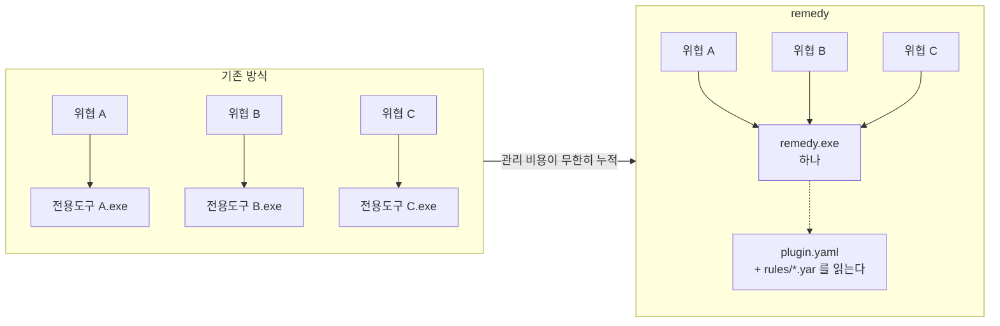

---

## 2. 지원 환경

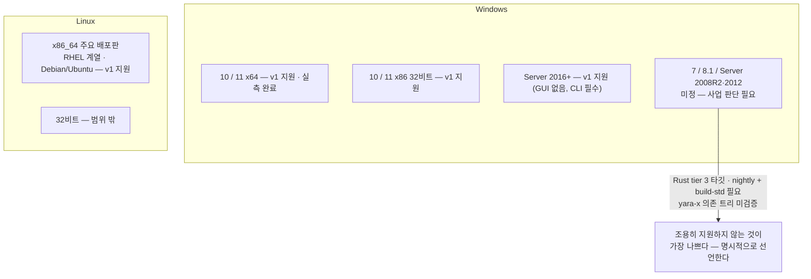

| | |
|---|---|
| **설치** | 없다. 실행 파일 하나를 복사한다 |
| **런타임** | 없다. CRT 정적 링크 — VC++ 재배포 패키지 불필요 |
| **네트워크** | **말하는 코드가 링크되어 있지 않다.** `cargo xtask static` 이 임포트를 전수 확인한다. 폐쇄망에서 그대로 돈다 |
| **권한** | **관리자(Windows) · root(Linux) 를 요구한다.** PC 를 변경하는 명령은 권한이 없으면 시작하지 않고 종료 코드 5 로 그렇게 말한다. 넘겨받은 파일만 읽는 명령(`evaluate` · `plan` · `plugin lint` 등)은 요구하지 않는다 |
| **화면 언어** | **한국어·영어 둘.** 기본은 OS 로케일이고 `--lang` 이나 `REMEDY_LANG` 으로 고른다. 고객 명령이 내는 문구는 **사유까지** 두 언어다 — 틀만 번역하면 `not restorable  ctime: 커널이 관리하며…` 처럼 한 줄 안에서 섞인다 |
| **화면 문체** | 고객 경로의 한국어는 **실패·거절·미룸 사유까지 전부 합쇼체**(2026-09-30 결정). 개발자용 `--help-all`·`plugin lint` 설명만 해라체로 남긴다. 장식은 절제한 ASCII 아트(배너 괘선·`*`·`-` 목록)이고, 옛 콘솔에서 2칸으로 그려지는 `·`·`→`·`…` 는 정렬이 깨지지 않아 그대로 둔다(실측) |

---

## 3. 동작 방식 — 네 단계가 파일로 나뉜다

**PC 를 바꾸는 동작은 실행 전에 계획으로 완전히 확정된다.** 각 단계가 파일로
끊기고, `apply` 는 `plan.json` 에 적힌 것만 수행한다.

> **이 문서에서 "변경"이란** 파일 삭제·격리, 레지스트리 값 제거·수정, 예약
> 작업 삭제, 프로세스 종료를 통틀어 가리킨다. 설계 문서와 코드는 같은 것을
> **"파괴"** 라고 부르며, 그 용어를 그대로 인용하는 자리가 아래 몇 군데 있다
> (`파괴 Action` · `arch` 게이트의 "파괴 코드").

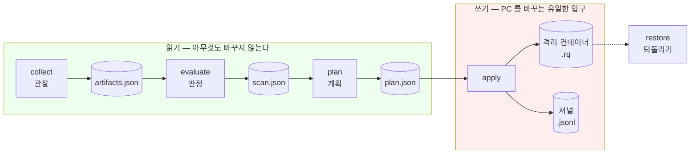

`scan` 은 앞의 셋을 한 번에, `run` 은 넷을 한 번에 한다.

### 네 파일에 무엇이 들어 있나

단계마다 파일을 하나씩 남긴다. **다음 단계는 앞 단계의 파일만 읽는다** — PC 를
다시 들여다보지 않는다.

| 파일 | 만드는 단계 | 무엇이 들었나 |
|---|---|---|
| `artifacts.json` | `collect` | **본 것.** 관찰 대상(subject)별로 나뉜다 — `file` · `process` · `autorun`(자동 실행 등록) · `persistence`(예약 작업·서비스) · `av_exclusion`(백신 예외 목록) 등. 각 항목의 경로·해시·서명·시각이 함께 들어간다 |
| `scan.json` | `evaluate` | **판정한 것.** `evidence` 에 "룰의 어느 조건이 어디에 맞았는가" 가 한 건씩 들어가고, `verdicts` 에 그것을 묶은 감염 판정이 들어간다 |
| `plan.json` | `plan` | **하려는 것.** `actions` 배열에 한 건씩 — `seq`(순번) · `op`(어느 Op 인가) · `target`(무엇을) · `because`(어느 증거 때문인가) · `reversible`(되돌릴 수 있는가) · `risk` |
| `journal/<회차>.jsonl` | `apply` | **한 것.** 한 줄이 한 사건이다 — `Start`(어느 계획으로 시작했나 · 계획 파일의 해시 · 어떤 바이너리가 돌았나) · `Intent`(이제 이것을 하겠다) · `Backup`(격리에 담았다) · `Outcome`(결과) · `Failed` · `Deferred` · `End` |

`plan.json` 한 건은 이렇게 생겼다.

```json
{
  "seq": 1,
  "op": "persistence.disable",
  "target": "\\Microsoft\\Windows\\Locust",
  "because": ["task#0"],
  "reversible": true,
  "risk": "medium"
}
```

*"1번으로, 예약 작업 `\Microsoft\Windows\Locust` 를 비활성화한다. `task#0` 이라는
증거 때문이고, 되돌릴 수 있다."* — `because` 가 비어 있으면 게이트 **G7** 이
막는다(§4). 근거 없이 뭔가를 지우는 계획은 만들어지지 않는다.

### 왜 파일로 끊는가

| 파생되는 성질 | 어떻게 |
|---|---|
| 드라이런의 정확성 | 계획이 곧 수행할 목록이다. 다르게 돌 여지가 없다 |
| 삭제 상한의 사전 차단 | 계획 단계에서 상한을 재고 거부한다 |
| 감사 완전성 | 계획과 저널을 대조하면 계획 밖 Action 이 0 인지 나온다 (게이트 G3) |
| 계획의 이동 | `plan.json` 을 다른 PC 로 옮겨 `apply --plan` 으로 그대로 실행할 수 있다 |

### 승인과 실행

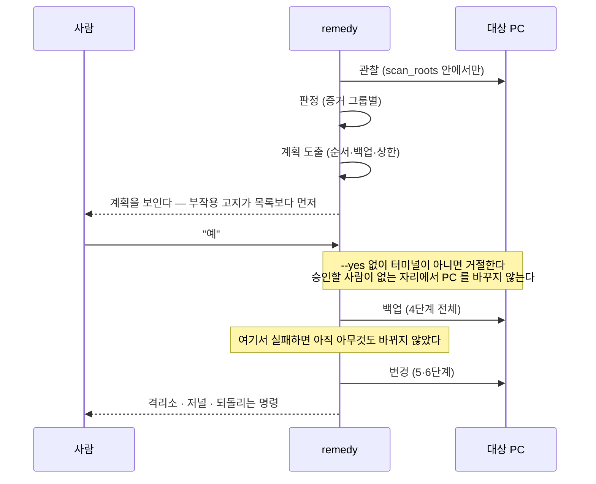

---

## 4. 안전장치 — 무엇이 잘못된 변경을 막는가

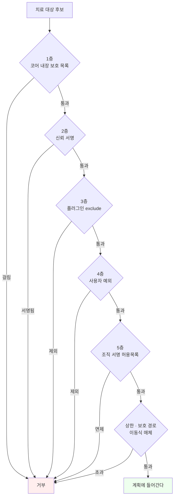

여기에 **자기 무결성**이 하나 더 있다. **서명해 둔 뒤 내용이 바뀐** 바이너리는
검사·보고만 하고 PC 를 바꾸지 않는다(종료 코드 5) — 부분 다운로드·디스크 손상·변조
중 하나이기 때문이다.

**서명이 아예 없는 것은 막지 않는다** (2026-09-02). 인증서는 공식 배포의
절차이지 기능의 조건이 아니다 — 그 규칙이 막던 것은 공격자가 아니라 시연·현장
검증·내부 시험이었다. 대신 매 실행에서 *"이 바이너리에 서명이 없다 — 공식
배포본이 아니다"* 라고 말한다.

### 출시 게이트 G1~G9

> **지금 어디까지 섰나 — G1~G7 통과**(시험이 잰다. G4 만 실기기) **· G9 통과**
> (릴리스 전 수동) **· G8 만 절반.** 그 둘은 표 아래에서 이어 읽는다.

| | 무엇을 | 통과 조건 |
|---|---|---|
| **G1** | 청정 환경 무해성 | **정상 PC 에서 떠 둔 상태 스냅샷**(청정 코퍼스 28벌) 전체에서 파괴 Action **0건** |
| **G2** | 복원 완전성 | `apply → restore` 뒤 해시·시각·소유자·권한 **100% 일치** |
| **G3** | 계획 완전성 | 계획에 없던 Action **0** |
| **G4** | 치료 유효성 | 재부팅 뒤 `verify` 에서 잔존·재생성 **0** · 재평가가 **다 봤다**(6 은 통과가 아니다 — 2026-10-26) |
| **G5** | 폭주 차단 | 상한 초과 계획은 무인에서 **중단** |
| **G6** | 보호 경로 불가침 | 1층 대상은 계획 단계에서 **거부** |
| **G7** | 증거 추적성 | `because` 가 빈 파괴 Action **0건** |
| **G8** | 서명 강제 | 미서명·변조·폐기 플러그인 **거부** |
| **G9** | 룰의 검체 오탐 | **정상 파일**을 모아 둔 자리에 룰을 전수로 돌려 오탐 **0건** · 못 훑은 것은 수와 사유 기록 |

**이 아홉은 `cargo xtask all` 의 아홉과 다른 것이다.** 저쪽(§10)은 *저장소가
규율을 지키는가* 를 매 빌드에 재고, 이쪽은 *제품이 안전한가* 를 시험·하네스·
사람이 나눠 잰다. 둘을 뭉뚱그리면 아래 둘이 가려진다.

**G8 이 절반인 까닭 — 검증은 되고 있고 강제가 아직이다.** 먼저 가를 것 하나 — G8 이
말하는 서명은 **플러그인 서명**이고, 바로 위에서 *"없어도 막지 않는다"* 고 한
것은 **바이너리 자기 서명**이다. 둘은 다른 자물쇠다. 플러그인 쪽에서 앵커(이
빌드가 믿기로 한 공개키)·서명
매니페스트·폐기 목록·역행 금지와 `plugin verify` 는 전부 동작한다. 서지 않은
것은 *강제*이고, 지금 강제가 도는 자리는 **안내 모드 하나**다 — 인자 없이
실행하면 옆에 놓인 룰 중 **검증을 통과한 것만** 고를 거리에 오르고, 하나도
없으면 종료 코드 5 로 멈춘다. 반면 `run --plugin <경로>` 로 직접 준 매니페스트는
**서명을 보지 않는다.** 나머지 절반은 릴리스 키가 서야 켠다 (§14 · 설계-09 P10-A2).

**G9 가 수동인 까닭 — 전수 스캔이라 매 커밋에 못 넣는다.** 룰을 정상 파일
코퍼스에 전수로 돌리는 게이트여서 **릴리스 전에 분석가가 돌리고 결과를 릴리스
기록에 첨부한다.** 그렇게 통과했다 — 정상 파일 **274,498개 · 오탐 0건 · 상한
탓 미측정 0건**. 자동화는 P13 `enrich` 의 몫이고, 그때까지 수동이라는 이유로
건너뛰지 않는다 (설계-03 §10).

### 무엇으로 재는가 — 하네스

게이트는 주장이고, 그 주장을 세우는 것은 **실기기에서 받은 화면**이다.

| | |
|---|---|
| **콘솔 기준선 넷** | `console-{win,linux}.txt` 와 그 영어판. 화면을 바꾼 회차는 **넷을 다 받아** `cargo xtask console-diff` 로 견준다 |
| Windows | `host\Capture-Console.ps1 [-Build] [-Lang ko\|en]` — 랩 VM 에서 감염 → 검사 → 치료 → 복원 **31절** |
| Linux | `linux/capture-console.sh` (+`CAPTURE_LANG=en`) — 같은 순서 + 일부러 일으킨 종료 코드 3·5·6·7, **42절** |
| 정규화 | 실행 번호·시각·단위 붙은 수·호스트명·열쇠 지문(`local`·`org`)을 자리표시자로 바꾸고 심장박동 줄을 뺀 뒤 견준다 — 화면을 바꾸지 않은 회차는 `diff 0` 이어야 한다(2026-09-30 실측) |
| 캡처로는 볼 수 없는 갈래 | **시험이 대신 확인한다.** 가드 사유·거절 사유처럼 화면에 잘 안 뜨는 갈래는 시험 래퍼나 생성자를 좁혀 강제한다 |

> `diff 0` 은 *"안 깨졌다"* 이지 *"됐다"* 가 아니다. 바꾼 것이 캡처에 보이는지
> 먼저 확인하고, 안 보이면 그것을 재는 다른 자를 찾는다.

---

## 5. 설계의 척추 셋

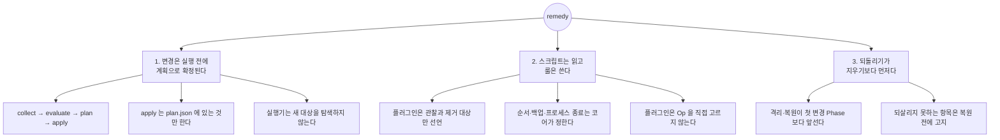

---

## 6. 무엇을 배포하는가

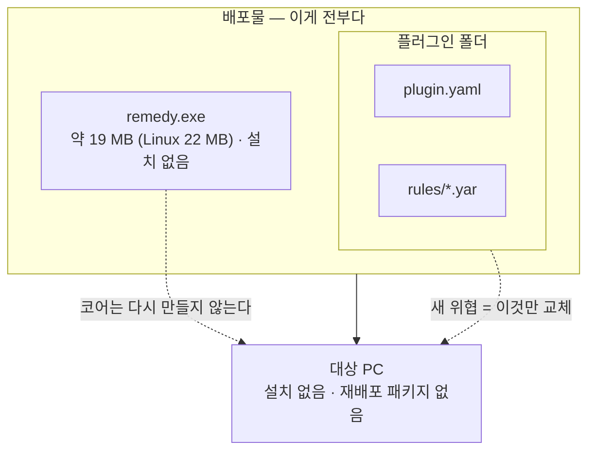

```
배포 폴더/
├── remedy.exe            ← 서명된 릴리스 빌드
└── <위협이름>/
    ├── plugin.yaml       ← 분석가가 쓴다
    └── rules/
        └── *.yar         ← 분석가가 쓴다 (코어가 이름순으로 읽는다)
```

| 필요한 것 | 왜 |
|---|---|
| **코드서명** | **기능의 조건이 아니다**(2026-09-02 결정 · §4). 서명 없이 전부 동작하고 매 실행에서 *"공식 배포본인지 스스로 확인하지 못합니다"* 라고 말한다(받은 파일은 체크섬으로 확인한다). 막는 것은 **서명해 둔 뒤 바뀐** 바이너리뿐이다(exit 5) |
| 관리자 권한 | 예약 작업·HKLM 을 다루려면. **없으면 시작하지 않는다**(exit 5) |
| `%PROGRAMDATA%\remedy` | 격리물·감사 로그·회차 로그가 쌓이는 자리. **되돌리려면 이게 있어야 한다.** `--state-dir` 로 옮길 수 있다 |

---

## 7. 분석가가 쓰는 것 — `plugin.yaml`

**Op 을 고르지 않는다.** *무엇을 관찰하고 무엇을 없앨지*만 선언하면 순서·백업·
프로세스 종료는 코어가 도출한다.

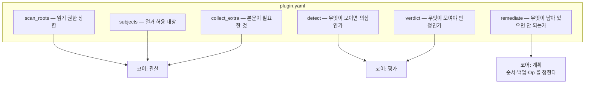

### 키 전수

| 키 | 필수 | 무엇 |
|---|---|---|
| `schema_version` | ● | 지금은 `1` |
| `id` | ● | 전역 고유 `[a-z0-9-]+` |
| `version` | ● | semver. 폐기 목록의 `min_plugin_version` 이 본다 |
| `min_core` | ● | 요구 코어 최소 버전. 린트가 이 코어와 비교한다 |
| `platforms` | ● | `[windows]` · `[linux]` · 둘 다 |
| `name` | ● | `{ ko, en }` |
| `scan_roots` | ● | **읽기 권한 상한** — 성능 최적화가 아니다 |
| `subjects` | ● | 선언하지 않은 subject 는 `detect` 에서 못 쓴다 |
| `detect` | ● | 탐지 규칙 |
| `verdict` | ● | 판정식 (불 대수. **점수 임계값 문법은 없다**) |
| `allow_removable` | | 이동식 매체. 기본 `false` |
| `references` | | 근거 링크 |
| `signed_malware` | | 서명된 악성코드 예외 |
| `remediate` | | 제거 선언 |
| `collect_extra` | | 본문 수집 |
| `submit_hint` | | 손으로 올릴 때 볼 판단 근거 |

> **알 수 없는 키는 무시가 아니라 거부다.** 오타 난 키가 조용히 빠지면 그 선언은
> 없는 것이 되고 아무도 모른다.

### 절대 규칙 넷

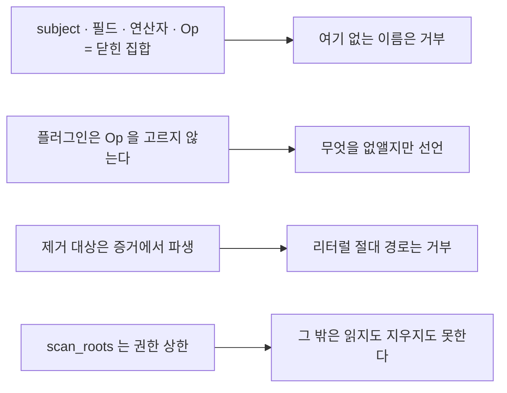

### 부모–자식 구조 (증거 그룹)

감염이 둘이면 그룹도 둘이고, 서로의 증거가 섞이지 않는다.

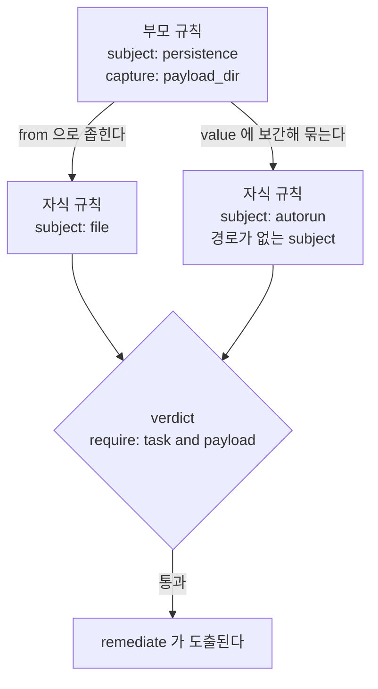

부모가 `capture` 로 뽑은 값을 자식이 쓴다.

- **경로가 있는 subject** — `from: "${task.payload_dir}"` 로 스캔 범위를 좁힌다.
- **경로가 없는 subject**(레지스트리 값·프로세스·예외 목록) — `where` 의
  `value` 에 `"${task.payload_dir}"` 를 넣어 묶는다.

**리터럴 경로 조각으로 대신하지 않는다.** 그러면 다른 감염 인스턴스의 항목까지
이 그룹에 붙는다.

---

## 8. 코어가 아는 것 — 닫힌 집합 넷

**넷 다 "더 늘지 않는 목록"이다.** 여기 없는 것을 룰이 쓰면 린트가 거부한다 —
이 프로그램이 할 수 있는 일의 경계가 곧 이 목록이기 때문이다. 늘리려면 코어를
고치고 새 판을 내야 하고, 그래서 **룰만 배포해서 늘릴 수는 없다.**

### subject 21종 — 무엇을 볼 수 있는가

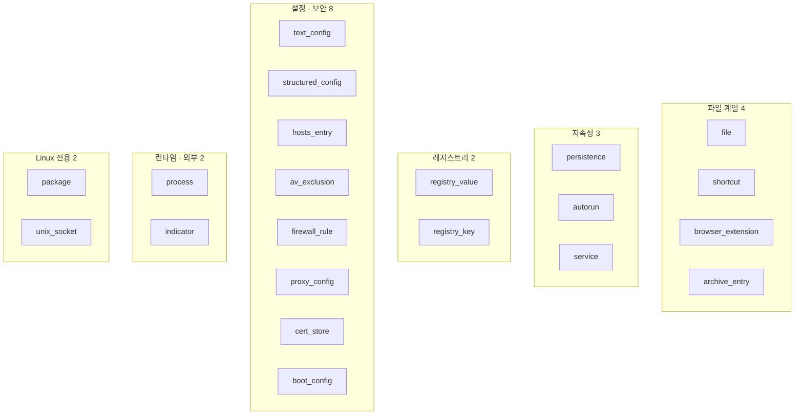

> `package` 와 `unix_socket` 은 **Linux 전용**이다(`windows: false`). 둘 다 정해진 자리를
> 파일로 직접 읽고(dpkg·apk·rpm DB · `/proc/net/unix`) **치료 Op 이 없다** — 패키지를 올리는 것은
> 공급사의 일이고, 소켓을 닫는 것은 치료가 아니다(그 소켓을 연 프로세스가 다시 연다). `unix_socket`
> 은 코어 1.2.0 에서 더했다 — Ebury 의 현재 주 탐지법이 추상 소켓 이름이다(설계-01 D11 덧붙임).
>
> `archive_entry` 는 코어 1.11.0 에서 더했다 — jar · war · ear 안의 항목(안쪽 경로 · 해시 · 작은 글자
> 내용)을 읽는 **찾기 전용** subject 다. log4j 점검을 룰만으로 짜 보니 YARA 가 압축된 항목의 속을 못 봤다.

### Op 29종 — 코어가 할 수 있는 변경

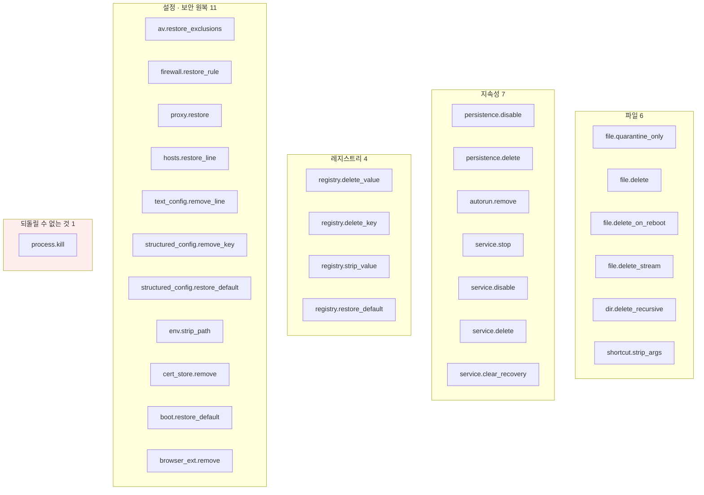

`process.kill` 만 되돌릴 수 없다. 그래서 **되돌릴 수 있는 Action 보다 먼저**
배치되고 멱등하게 설계된다.

### 격리 엔트리 14종 · 연산자 15종

| 엔트리 종류 | |
|---|---|
| `File` · `FileStream` · `Directory` | 파일 계열 |
| `RegistryValue` · `RegistryKey` | 레지스트리 |
| `Task` · `Service` · `Cron` · `Unit` | 지속성 (플랫폼마다 다른 실체) |
| `TextLine` · `StructuredConfig` | 설정 |
| `AvExclusion` · `CertStore` · `BootConfig` | 보안 설정 |

연산자 **16종**: `equals` · `not_equals` · `matches` · `contains` ·
`starts_with` · `ends_with` · `in` · `glob` · `exists` · `gt` · `lt` ·
`version_lt` · `pkg_version_lt` · `rpm_version_lt` · `version_gt` · `yara`

> **`pkg_version_lt` 가 빠져 있었다** (2026-10-29 에 더했다). 2026-10-27 에
> 들어온 연산자인데 이 목록만 열넷으로 남아 있었다 — 어느 게이트도 이 문서를
> 읽지 않는다. 수의 출처는 `docs/plugin-guide/machine/catalog.json` 이고
> `cargo xtask schema` 가 그것을 SDK 와 대조한다.

---

## 9. AI 가 룰을 쓸 때 보는 곳

**문맥에 파일 하나만 넣을 수 있다면 `machine/AI-CONTEXT.md` 다** — 전수 카탈로그와
최소 예제를 8 KB 로 압축한 **생성물**이다.

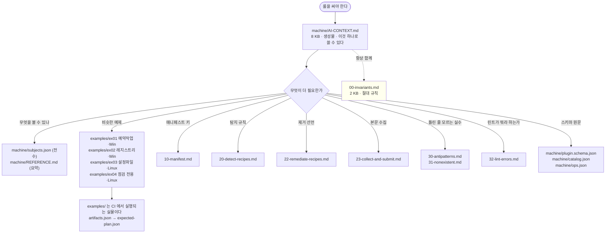

### 폴더 전수

```
docs/plugin-guide/
├── README.md                 라우터 — 무엇을 하려면 어디를 읽는가
├── 00-invariants.md          절대 규칙 (2 KB · 항상 읽는다)
├── 01-quickstart.md          동작하는 플러그인 하나 + 반복 루프
├── 10-manifest.md            매니페스트 키
├── 20-detect-recipes.md      탐지 규칙
├── 22-remediate-recipes.md   제거 선언
├── 23-collect-and-submit.md  본문 수집 · 제출 힌트
├── 24-check-plugins.md       점검 전용 — remediate 없음 (2026-10-25)
├── 30-antipatterns.md        틀린 줄 모르고 쓰는 것
├── 31-nonexistent.md         있을 것 같지만 없는 문법
├── 32-lint-errors.md         린트 메시지별 대처
├── 40-review-checklist.md    리뷰 체크리스트
├── examples/                 CI 에서 실행되는 실물 넷 (제거까지 둘 · 탐지만 하나 · 점검 하나)
│   ├── ex01-scheduled-task/  예약 작업 · Windows
│   ├── ex02-registry-ifeo/   레지스트리 IFEO · Windows
│   ├── ex03-text-config/     설정 파일 · Linux
│   └── ex04-check-only/      점검 전용 · Linux — 계획이 빈다
│       └── (각각 plugin.yaml · artifacts.json · expected-plan.json · README.md)
└── machine/                  프로그램이 읽는 것 (생성물)
    ├── AI-CONTEXT.md         압축 문맥 8 KB ← 하나만 고르면 이것
    ├── REFERENCE.md          사람이 읽는 요약
    ├── plugin.schema.json    매니페스트 스키마 (권위 있는 정의)
    ├── artifact.schema.json  아티팩트 스키마
    ├── catalog.json          카탈로그 전수
    ├── ops.json              Op 전수
    └── subjects.json         subject·필드 전수
```

> `machine/` 은 **생성물**이다. SDK 에서 나오고 `cargo xtask schema` 가 매 커밋
> 일치를 확인한다 — 손으로 고치면 다음 생성에서 덮인다.

### 쓰고 나서 반드시

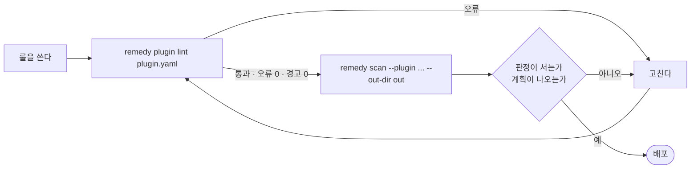

**린트가 실기기 전에 잡는 것 중 가장 흔한 것**: YARA 를 쓰면서 `collect_extra`
로 본문을 담지 않은 경우. 그러면 그 규칙은 실기기에서 **미평가**가 되고 판정이
서지 않는다 — 감염된 기계에서도 판정 대신 종료 6 이 나온다(2026-10-25 까지는
조용히 "위협 없음" 이었다).

---

## 10. 저장소 구조 — 크레이트 19종

> **크레이트**는 Rust 에서 따로 컴파일되는 코드 묶음이다 — 다른 언어의
> 모듈·패키지에 해당한다.

크레이트를 쪼갠 이유는 모듈성이 아니라 **컴파일러가 안전 규칙을 지키게 하기
위해서**다. 아래 금지는 주석이 아니라 의존 그래프다.

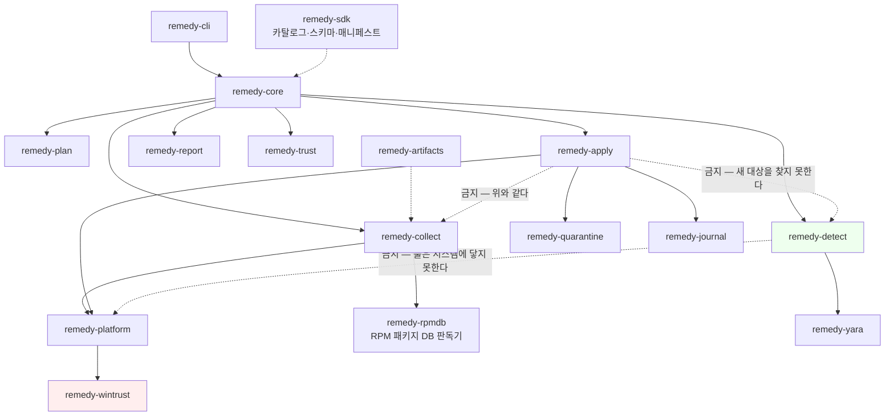

| 금지된 의존 | 이것이 보장하는 것 |
|---|---|
| `remedy-detect ↛ remedy-platform` | **플러그인 룰은 시스템에 접근할 수 없다.** 탐지는 불활성 스냅샷 위에서만 |
| `remedy-apply ↛ remedy-detect` | **실행기는 새 대상을 탐색할 수 없다.** 계획에 있는 것만 |
| `remedy-apply ↛ remedy-collect` | 위와 동일 |
| `remedy-detect ↛ remedy-enrich` | **판정 코드가 조회를 호출할 수 없다.** 평가의 결정성 |
| `remedy-apply ↛ remedy-enrich` | 변경 경로에 네트워크 코드가 링크되지 않는다 |
| `remedy-collect ↛ remedy-apply` | **진단 모드에 파괴 코드가 링크되지 않는다** |
| `remedy-rpmdb ↛ remedy-platform` | **함께 쓰는 판독기는 받은 바이트만 읽는다** — 그래야 동반 모듈도 같은 판독기를 쓴다 |
| `remedy-cli ↛ remedy-net` | **본체는 동반 모듈을 링크하지 않는다** — 통신은 그 바이너리에만 |
| `remedy-net ↛ remedy-apply` · `↛ remedy-platform` | 동반 모듈에 파괴 경로 · OS 원시 연산이 없다 |
| `remedy-cli ↛` 네트워크 크레이트 | 본체 의존 트리 전체에 HTTP · TLS · 소켓 크레이트가 없다 |

뒤의 셋은 한 문장이다 — **고객 PC 에서 도는 경로에는 네트워크를 말하는 코드가
존재하지 않는다.**

위 그림에 없는 셋: `remedy-enrich`(P13 · 사내 조회, **치료 경로에 링크되지
않는다**) · `remedy-testkit`(시험 도우미) · `remedy-net`(동반 모듈 — 본체가 하지 않는
점검을 맡는 별도 바이너리: 웹서버 원격 확인 `url` · 이미지 파일 `image` · 컨테이너 `container`. 본체는 링크하지
않고, 네트워크 점검 룰을 고르면 서명을 확인한 그 실행 파일을 띄워 종료 코드만 받는다 — 설계-04 §1. `image` ·
`container` 는 사람이 직접 실행한다).

> `remedy-wintrust` 만 `unsafe` 를 쓴다. 나머지 18종은 `#![forbid(unsafe_code)]`.
> 그 하나의 이유는 `WinVerifyTrust` 의 안전 래퍼가 crates.io 에 없기 때문이다.

### 규칙은 문서가 아니라 CI 가 지킨다

```bash
cargo xtask all      # 열하나를 한 번에 (아래)
cargo xtask static   # 배포될 바이너리의 임포트 전수 — 네트워크 없음 확인
cargo fmt --all -- --check
cargo clippy --workspace --all-targets -- -D warnings
cargo deny check
```

| `xtask all` 이 보는 것 | 무엇을 |
|---|---|
| `arch` | 금지 의존 10건 · 본체 의존 트리에 HTTP · TLS · 소켓 크레이트 0 · 제품 바이너리 이름 |
| `unsafe` | 19 중 18 이 `#![forbid(unsafe_code)]` |
| `trace` | 설계 인벤토리가 Phase 계획에 전부 반영됐는가 |
| `schema` | 생성물 10개가 생성기(SDK · `remedy-net`)와 일치하는가 |
| `가이드` | 문서 18개의 크기 예산과 헤더 |
| `console-doc` | `콘솔은-이렇게-보인다.md` 가 인용한 화면이 **기준선에 실제로 있는가** |
| `screens` | 고객이 읽는 화면에 쓰지 않기로 한 말이 돌아왔는가 |
| `snapshots` | 스냅샷 48개가 카탈로그와 맞는가 |
| `실기기` | 위협 20개의 치료 결과가 **지금 자료로** 재어졌는가 |
| `plugin-lock` | 룰을 고친 플러그인이 버전을 올렸는가 |
| `threats` | README 의 *다루는 위협* 표가 룰 매니페스트와 같은가 |

`arch` 의 금지 의존 목록과 `trace` 의 인벤토리는 **코드에 박혀 있지 않고 설계
문서에서 읽는다.** 같은 사실을 두 곳에 적으면 반드시 갈라지기 때문이다.

### 리눅스 검사는 스크립트 하나로 끝난다

Windows 에서만 개발하면 **비Windows 컴파일 결함이 원리적으로 보이지 않는다** —
P2 에서 실제로 그렇게 깨졌다. `ci/linux-check-local.sh` 가 WSL·docker 에서 그
잡을 대신 돈다(2026-09-19 실측: `deny` 를 뺀 일곱 단계 통과, 종료 코드 2).

```bash
REPO=<저장소의 WSL 경로> CARGO_HOME=<Windows 쪽 .cargo 의 WSL 경로> \
    ci/linux-check-local.sh
```

**건너뛴 것은 통과가 아니다** — 종료 코드가 0(전부 봄)·2(봤지만 못 본 것이
있음)·1(실패)로 갈린다.

---

## 11. 명령 15종

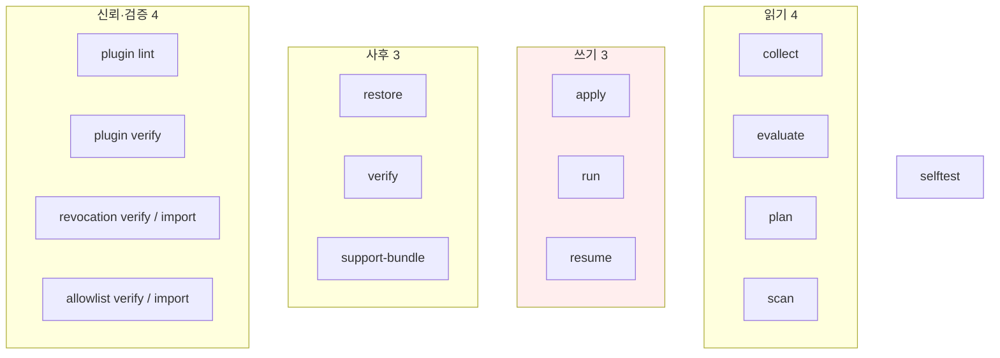

### 무엇을 하는가 — 고객이 쓰는 일곱

| 명령 | 하는 일 | 이 명령만의 성질 |
|---|---|---|
| `run` | 수집→판정→계획→치료를 한 번에 | 재부팅 뒤 재평가를 **자동 예약**한다(아래) |
| `scan` | 앞의 셋만. **아무것도 바꾸지 않는다** | 산출물 셋을 남겨 다른 PC 에서 이어받을 수 있다 |
| `apply` | 이미 만든 계획만 수행 | **PC 를 바꾸는 유일한 입구.** `--yes` 없이 터미널이 아니면 거절한다 |
| `resume` | 저장된 계획을 이어 실행 | **절대 재스캔하지 않는다** — 승인받은 것과 다른 일이 벌어지면 안 된다 |
| `restore` | 되돌린다 | `--list` 는 **열쇠 없이 헤더만** 읽는다. 되살리지 못하는 항목을 **복원 전에** 고지 |
| `verify` | 치료가 유지됐는가 | 경로가 비었는지가 아니라 **판정이 재현되는지**를 본다. 다 보지 못하면 *치료 성공* 대신 6 이다(2026-10-26) |
| `support-bundle` | 신고에 붙일 것을 모은다 | 담은 것과 **일부러 담지 않은 것**을 함께 보인다. 제출은 사람이 |

개발자·플러그인 작성자용 여덟(`collect`·`evaluate`·`plan`·`plugin lint|verify`·
`revocation`·`allowlist`·`selftest`)은 화면 문구가 한국어로 남는다 — 고객이 보는
자리가 아니기 때문이다(2026-09-06 결정).

### 무인 배포에서 쓰는 것

```bash
remedy run --plugin .\plugin.yaml --out-dir .\out --yes --events .\out\run.ndjson
```

| | |
|---|---|
| `--yes` | **"묻지 말라" 가 아니라 "화면 앞에 사람이 없다" 는 선언이다.** 계획기가 이 값으로 이동식 매체 대상을 가른다 — 무인에서는 수행하지 않는다 |
| `--dry-run` | 계획까지만. **계획이 곧 수행할 목록**이라 드라이런과 실제가 갈라지지 않는다 |
| `--events <파일\|->` | 진행을 NDJSON 으로 낸다. **사람이 읽는 출력과 다른 스트림이다** — 문구를 파싱하지 말고 이것을 읽는다 |
| `--config <설정.yaml>` | 상한·정책을 파일로. 설정 파일 하나 + 명령행 인자가 전부다 |
| 종료 코드 | 아래 여덟 가지. 스크립트는 문구가 아니라 이것을 본다 |

**재부팅 뒤 재평가가 자동 예약된다.** `run --plugin` 이
`HKLM\…\RunOnce\remedy-verify` 를 걸고 OS 가 실행 뒤 지운다. 잠긴 파일은 재부팅
후에 사라지므로 **치료 유효성(G4)은 그때 확인된다.** `apply --plan` 은 룰 경로를
몰라 예약하지 못하고 그 사실을 경고로 말한다. 그 판정은 상태 디렉터리의
`verify/<회차>.jsonl` 에 남고, **`clean`(0)만 치료 유지다** — 판정도 남은 증거도 없는데
다 보지 못한 재평가는 `incomplete`(6)로 적히고, 다 보지 못했으면 결과와 무관하게 무엇을
못 봤는지가 같은 줄에 실린다(2026-10-26 부터).

그 예약에는 **이 회차의 언어가 실린다** — 재부팅 회차는 `REMEDY_LANG` 을
물려받지 못하므로, 싣지 않으면 한 회차의 로그가 두 언어로 갈린다.

### 사람이 보고 있을 때 — 진행 표시

오래 걸리는 단계에서 **심장박동**이 지금 무엇을 하는지 말한다. 조용한 도구는
멈춘 도구와 구분되지 않는다.

| | |
|---|---|
| 무엇을 보이나 | 현재 단계 · 훑은 디렉터리 수 · 마지막 경로 · 외부 도구가 상한을 넘겼는가 |
| 언제 | `--events` 가 없고 사람이 앞에 있을 때. **파이프로 넘기면 나오지 않는다** |
| `--ascii` | 장식 문자를 ASCII 로. UTF-8 이 아닌 로케일에서는 자동이다 |
| `--verbose` | 룰 진단·산출 파일 경로까지. 평소 화면은 **무엇을 했는가**만 보인다 |

### 인자 없이 부른 사람 — 안내 모드

홈페이지에서 받아 **더블클릭한 사람**이 가는 길이다(2026-09-09~11). 창이 곧바로
닫히지 않고, 옆에 놓인 룰 폴더를 찾아 무엇을 할 수 있는지 보인다.

| | |
|---|---|
| 룰을 못 쓰면 | **왜 못 쓰는지** 말한다 — 앵커(믿을 공개키) 없음 · 서명 없음 · 변조 |
| 기다리는 자리 | **인자가 없고 사람이 앞에 있을 때만.** 인자가 하나라도 있으면 기다리지 않는다 |
| 권한이 없으면 | `'관리자 권한으로 실행'` 을 어디서 고르는지까지 적는다 |

### 종료 코드 — 무인 배포에서는 이것이 전부다

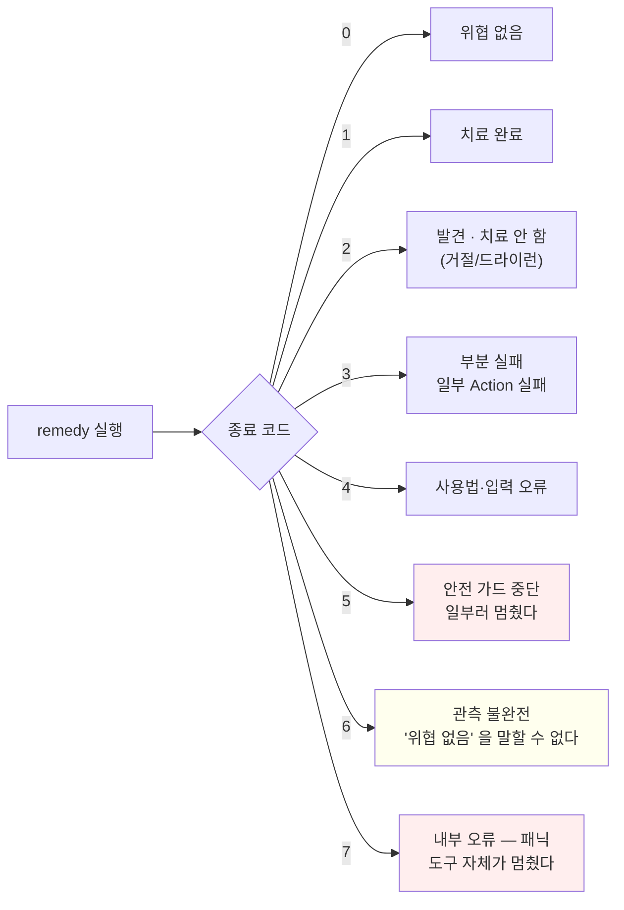

> **6 을 0 으로 취급하면 안 된다.** 다 보지 못한 것이고(수집이 잘렸다 · 접근이
> 거부됐다 · 선언한 자리가 전부 없다 · 선언한 subject 를 모으지 못했다 · YARA 규칙을
> 재지 못했다 — YARA 는 2026-10-26 부터), *"위협 없음"* 과 완전히 다른 뜻이다.
> 재검사(`verify`)도 같다 — 다 보지 못하면 *"치료 성공"* 대신 6 이다(2026-10-26 부터).
>
> **7 은 도구의 결함이다.** 패닉 훅이 사유를 회차 로그에 남기고 그 자리를
> 가리킨다(2026-09-07) — 조용히 죽으면 무엇이 일어났는지 아무도 모른다.

**사유도 화면 언어를 따른다.** 종료 코드만 숫자로 남고, *왜* 그 코드인지는
한국어·영어 중 그 회차의 언어로 나온다. 무인 배포가 5 를 받고 사유를 못 읽으면
그 코드는 반만 쓸모 있다.

---

## 12. 되돌리기 — 이 도구의 핵심 주장

오탐이 없다고 주장하는 대신 **틀렸을 때 되돌릴 수 있다**고 말한다.

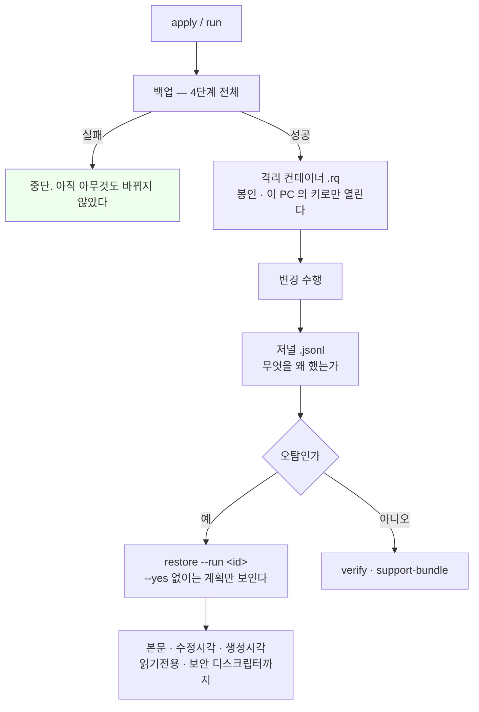

| | |
|---|---|
| **되살리지 못하는 항목** | 복원 **전에** 목록으로 고지한다. 조용히 빠지면 사용자는 완전했다고 믿는다 |
| **롤백하지 않는다** | 중간 실패해도 나머지를 계속하고, 되돌리기는 사람이 결정한다 |

### 누가 열 수 있는가 — 열쇠 겹 셋 (wrap)

컨테이너는 내용키 하나를 **여러 겹으로 싸 둔다.** 어느 겹이든 하나만 풀면 열린다.

| wrap | 누가 | 없으면 |
|---|---|---|
| `local` | 이 PC 의 키 | 기본 경로. **이것만 있으면 재설치 시 열 수 없다** |
| `pass` | 사용자 패스프레이즈 (`--passphrase-file`) | 실질적 기밀성이 생기는 유일한 경로 |
| `org` | 조직 복구 공개키 (`--org-key-file`) | 감염 호스트에 **개인키가 없어** 훔칠 것이 없다 |

**wrap 이 하나도 없으면 만들지 않는다.** 아무도 열 수 없는 컨테이너를 만들어
두고 원본을 지우는 것은 **되돌릴 수 없는 삭제**다.

넘겨받은 격리물은 원본 자리에 쓰지 않고 `--extract-to <디렉터리>` 로 꺼낸다 —
이 PC 의 저널에 *"우리가 그 자리에서 담았다"* 는 기록이 없기 때문이다.

### 어디까지 고를 수 있나

| | |
|---|---|
| `restore --list` | 되돌릴 수 있는 회차를 늘어놓는다. **열쇠 없이 헤더만** 읽는다 |
| `--run <run_id>` | 그 회차를 통째로 |
| `--entry <id>` (여러 번) | **항목 하나씩.** 셋을 지웠는데 하나만 오탐일 때 |
| `--container <파일>` | 회차 기록이 없어도 컨테이너 파일로 직접 |
| `--yes` 없이 | **계획만 보인다.** 아무것도 되돌리지 않는다 |

---

## 13. 이 도구가 하지 않는 것


---

## 14. 아직 없는 것

| | |
|---|---|
| **정식 코드서명 인증서** | 발급 대기. **기능은 서명 없이 전부 동작한다**(2026-09-02) — 공식 홈페이지 배포본에만 서명한다. 내부 시험·사내 사용은 서명 없이 쓴다 |
| 서명된 룰만 로드 (P10-A2 · **G8 의 나머지 절반**) | 검증은 다 된다. **강제가 도는 자리가 안내 모드 하나**다 — 옆에 놓인 룰은 검증을 통과한 것만 고를 거리에 오른다. 반면 `run --plugin <경로>` 로 직접 준 매니페스트는 **서명을 보지 않는다.** 릴리스 키가 서야 켠다 (§4) |
| 사내 분석시스템 연동 (P13) | `enrich` — 설계만 서 있다. **치료 경로는 이것 없이 완결이다** |
| ~~GUI (P15)~~ | **짓지 않기로 결정**(2026-09-30). CLI 로 개발을 마감했다 — 대신 콘솔 화면을 마감했다(고객 경로 전부 합쇼체 · `1b2fffc`) |
| 잠긴 안전 모드 키 해제 | **짓지 않기로 결정**(2026-08-31). 탐지·보고는 하고 푸는 것은 운영자 절차로 안내 |
| **영어 OS 에서의 화면** | 랩이 한국어 Windows 하나뿐이라 재지 못했다. OS 가 주는 문구(`os error 2` 등)는 우리가 고칠 수 없고, 그래서 판정 기준을 *"우리 문구에 한글 0"* 으로 잡았다 |
| `cargo deny` | 컴포넌트 설치에 네트워크가 필요해 리눅스 로컬 검사에서 **건너뛴다**. 건너뛴 것은 통과가 아니다 |

위 일곱 중 **지금 코드로 닫을 것은 없다.** 둘(GUI · 잠긴 안전 모드 키)은 짓지
않기로 정한 것이고, 인증서·랩 OS·네트워크·릴리스 키는 전부 조직이 정하는
자원이다. **하나만 성격이 다르다** — G8 의 로드 경로 강제는
코드로 닫을 수 있다. 닫지 않은 것은 못 해서가 아니라 **순서 때문이다**:
릴리스 키가 서고 저장소의 플러그인들이 서명되기 전에 켜면 아무 플러그인도
못 돌린 채 키 발급을 기다리게 된다 (설계-09 P10-A2). 그래서 이것도 결국
**키가 먼저다.**

---

## 15. 어디서 시작하는가

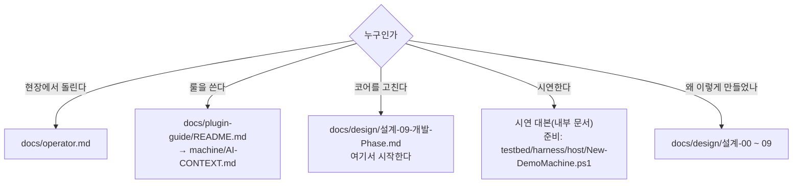

| 문서 | 내용 |
|---|---|
| `설계-00` | 위협 모델 · 범위 · 지원 대상 |
| `설계-01` | 아키텍처 결정 (D1~D10) |
| `설계-02` | SDK 계약 — 플러그인 스키마 |
| `설계-03` | 안전장치 · 출시 게이트 |
| `설계-04` | 저장소 구조 · testbed |
| `설계-05` | 사내 분석시스템 연동 — **내부 문서**, 공개 트리에 없다 |
| `설계-06` | 플러그인 작성 가이드 설계 |
| `설계-07·08` | 플러그인 워크스루 (설계 검증) |
| `설계-09` | **개발 Phase — 여기서 시작한다** |

### v1 을 닫기까지 남긴 기록

| 문서 | 무엇을 |
|---|---|
| `design/콘솔은-이렇게-보인다.md` | 화면 전수 — `xtask console-doc` 이 이 문서가 인용한 줄을 기준선과 대조한다 |
| `testbed/ai-exam/runs/` | **AI 합격 시험** 회차 기록 — 1차 주기 44회차(19종)와 2차 주기 3회차 |
| `윈도우-VM-배포-시험-절차-전달.md` | 랩 VM 하네스를 **다른 프로젝트가 옮겨 쓰는** 절차 |
| `design/설계-09-개발-Phase.md` "기능 개발 마감" 절 | **남은 것의 목록과 미룬 이유** — 마감 상태의 단일 원천 |

---

## 16. 다음 실제 위협 때 — 어디서 다시 시작하는가

**2026-10-02 에 여기서 멈춘다.** 기능(09-29) · 화면(09-30) · AI 합격 시험(10-02)이
닫혔고, 다시 여는 조건은 하나다 — **회사 차원에서 대응해야 할 실제 위협.** 그때
하는 일은 코어를 고치는 것이 아니라 **룰 하나를 쓰고 배포 파일을 내는 것**이다.
코어는 `1.0.0` 그대로 쓴다.

> **2026-10-25 에 재개됐다 — PHP2Shell.** 이번에는 룰만으로 끝나지 않는다 — **점검 도구**까지
> 요구됐고, 그 일에는 코어 판 올림이 든다. 아래 표는 그 가운데 **룰 쪽 순서**다.

```mermaid
flowchart LR
    T["실제 위협"] --> R["룰 — plugin.yaml<br/>docs/plugin-guide (사람 · AI)"]
    R --> L["remedy plugin lint<br/>cargo xtask exam (자동 채점 1~4)"]
    L --> M["실기기 채점 5<br/>랩 VM · 컨테이너"]
    M --> P["배포 폴더 — remedy 옆 plugins/<br/>§6"]
    P --> S{"릴리스 키 (§14)"}
    S -->|있다| SG["서명해서 배포"]
    S -->|없다| NS["서명 없이 배포 — 화면이 알린다<br/>기능은 전부 동작"]
```

| 순서 | 무엇을 | 어디 |
|---|---|---|
| 0. 환경 | 랩 VM·바이너리 해시·채점 명령은 `.cargo/*.yml` 에 있다(커밋하지 않는다). 먼저 `cargo xtask all` 이 그대로 통과하는지 본다 | `AGENTS.md` · `.cargo/host.yml` |
| 1. 룰 | 위협 하나에 `plugin.yaml` 하나. 사람은 `docs/plugin-guide/README.md`, AI 는 `machine/AI-CONTEXT.md` 부터. 값을 모르는 지문(해시)은 기계에서 뽑는다 — `20-detect-recipes.md` §값을 모르는 지문 | §7 · §9 |
| 2. 자동 검사 | `remedy plugin lint` → `cargo xtask exam --threat <id> --dir <회차>` (린트 · 청정 코퍼스 · 감염 탐지 · 계획 완결성). 새 위협이면 `THREAT.md` 와 감염 스냅샷부터 — 절차는 `testbed/ai-exam/README.md` | §4 · §9 |
| 3. 실기기 | Windows `host\Invoke-ExamApply.ps1 -Threat <id> -Plugin <룰> -Revert` · Linux `linux/invoke-exam-apply.sh --threat <id> --plugin <룰>`. 감염 스냅샷은 `New-ThreatSnapshot.ps1`. 랩을 새로 세우면 `윈도우-VM-배포-시험-절차-전달.md` | §4 |
| 4. 바이너리 | 코어를 건드리지 않았으면 2026-10-26 빌드 그대로(Windows `f574e093…` · Linux `b7a26444…`). 건드렸으면 둘 다 다시 짓고 **증거 21개를 다시 잰다** — 해시는 `.cargo/host.yml` 에 적는다. **해시가 다른 것만으로 코어를 건드렸다고 읽지 않는다** — 릴리스 빌드는 바이트 재현이 안 되어 `-Build` 한 번에 해시가 바뀐다(2026-10-26 에 `8c033721…` → `f574e093…`, 소스 동일). Windows 증거 13개는 아직 `8c033721…` 로 쟀다 — 코드가 같으니 내용상 현행이고, 다시 잴지는 열린 결정이다 | §6 · 설계-09 마감 절 |
| 5. 배포 폴더 | `remedy(.exe)` 옆 `<id>/plugin.yaml` 또는 `plugins/<id>/plugin.yaml` — 안내 모드는 두 모양을 다 찾는다. 받은 사람은 더블클릭한다. 서명은 릴리스 키가 서면 §14 의 G8 절반을 마저 켠다 | §6 · §11 |
| 6. 화면 | 화면 문구를 바꿨으면 기준선 4벌을 다시 받고 `console-diff` · `console-doc` 을 돌린다 | §4 · `콘솔은-이렇게-보인다.md` |

**건드리지 않아도 되는 것** — 코어 · 게이트 · 하네스 · 채점기. 워크스페이스 시험과
`cargo xtask all` 이 그대로 지키고 있다. **조직이 정해야 열리는 것** — §14 그대로다
(릴리스 키 · P13 의 API 키 · 영어 OS 랩).
